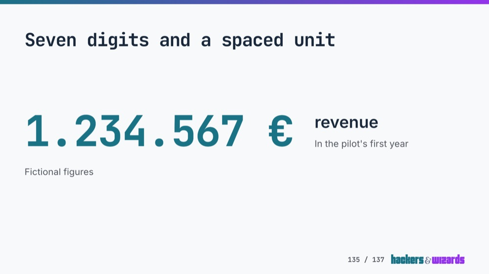
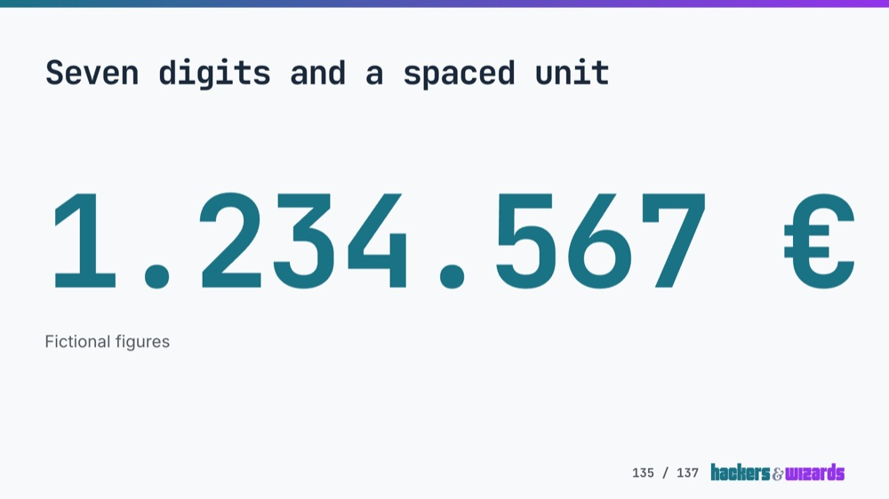
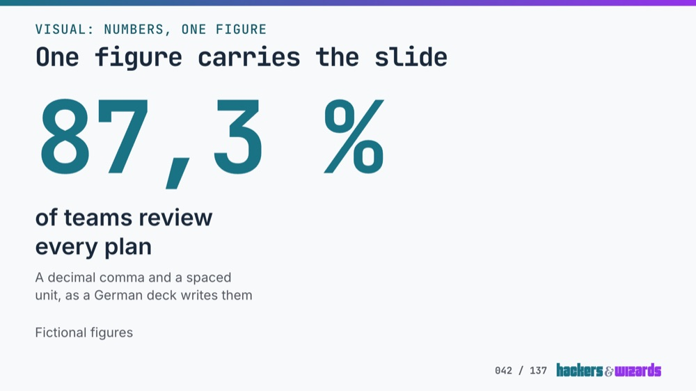
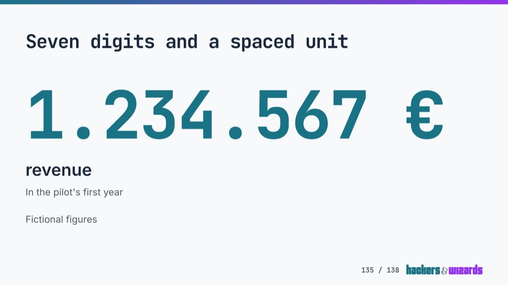
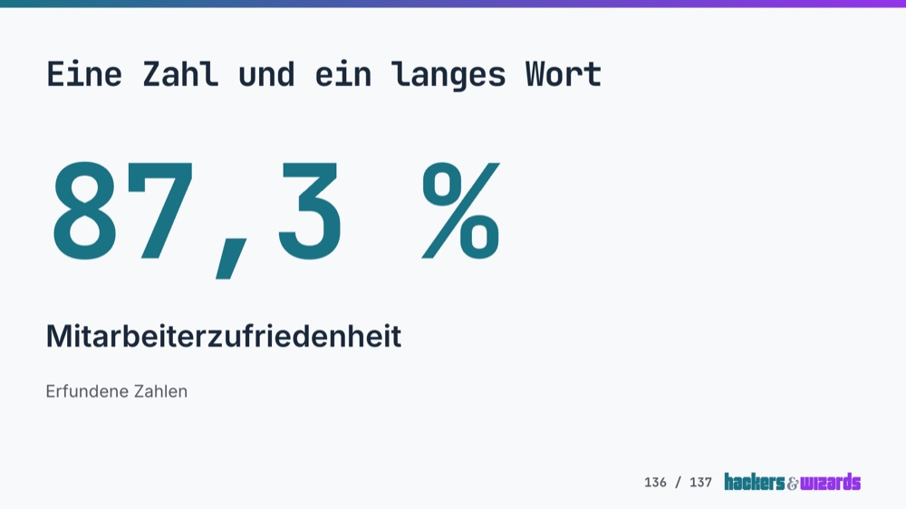

# A lone figure's two layout calls, the print view's shift and the story page's LCP, 11.11.2026

Slides v3.7.0 keeps the two layout calls v3.6.2 made for a lone figure, after a blind review that
scored them against the layout before and two alternatives. The gate now holds the cases v3.6.2
checked by hand. The print view no longer shifts on desktop, a deck's icon names are typed, and
`slides-pptx` writes a timeline figure's minus as the web does. The story page's slower LCP is
Lighthouse's simulation swinging, not a slower page.

## The blind review

v3.6.2 caps a lone figure on the stage at two thirds of its row and sets its label below it where
the label's longest word finds no room beside it. Neither call had a review.

### Versions and slides

- **A**, v3.6.2.
- **B**, the v3.6.0 layout with `whitespace-nowrap` kept: the figure at 13rem, the label beside it.
- **C**, derived: the figure always above its label, capped at the full row.
- **D**, round 2, from the reviewers' reasons against A: the figure capped at the full row, the
  label beside it while 22rem of the row stay free beside it, else below it at a closer gap.

Slides: "87,3 %" with a two-line label (short), "1.234.567 €" with the label "revenue" (long),
"87,3 %" with the label "Mitarbeiterzufriedenheit" (word), and in round 2 "12.345 %" with a
two-line label (five, a scratch slide). Each was built from the catalog and shot on its story page
at 1920 and 1440, on day and on night (the deck's `brand-dark` theme, which no live deck uses yet).

On a phone A, B and C draw alike: the phone rule stacks the figure and caps it, whatever the stage
does. Their shots match pixel for pixel, apart from 6 pixels one colour level apart on one pair. Two
shots of one build matched exactly at 390 and differed by one pixel at 1440, so that pair is near
the shot noise but not measured against it. No reviewer saw a phone. D differs on a phone, since
its 22rem basis acts on the label's height in the phone's column; it was not adopted. A and B draw
the short slide alike, so it was scored A against C only.

B pushes the label off the slide beside the long figure, 362 px past its row at 1920, and runs the
long word 70 px past it. The gate fails both, so B could only serve as a reference.

The reviewed shot of the word slide carries a German headline, which the specimen now has in
English. The headlines of the long and word slides were made neutral before any reviewer ran: the
first drafts named the layout under test ("beside a short label").

### Method

Two personas from the audience: a client's head of engineering watching a consultant present on a
1920 × 1080 meeting room screen (1920 shots), and a workshop participant opening the shared deck on
a 1440 px laptop (1440 shots). Each persona saw day and night in separate calls, both models
(`claude-opus-5-5` at effort medium, Codex `gpt-6.1-sol` at effort high), two runs each: 16
calls per round. Images downscaled to 1000 px, neutral letter labels and a shuffled order per call.
Six criteria of 10, fixed before any score, 60 at most. The decision rule was written down before
any output was read: a version replaces A only where, summed over the slides, it leads A in both
runs of both models by more than that model's noise, for both personas. Anything else keeps A.

One prompt, verbatim (the paths shortened to their file names):

> You are the head of engineering at a client company. In a quarterly review, a consultant presents
> a slide deck on the meeting room's screen, 1920 x 1080 pixels, which you watch from the table.
> Each image is one slide of that deck, shown here downscaled to 1000 pixels wide.
>
> Slide 1: image V (V.png), image X (X.png) show one slide in 2 versions.
> Slide 2: image K (K.png), image R (R.png), image W (W.png) show one slide in 3 versions.
> Slide 3: image Z (Z.png), image T (T.png), image M (M.png) show one slide in 3 versions.
>
> Score each image from 1 to 10 on each criterion:
>
> 1. The figure reads at a glance as the point of the slide.
> 2. The label clearly belongs to the figure and is easy to read.
> 3. Nothing looks cut off, crammed against an edge or out of line.
> 4. Breathing room, not cramped.
> 5. Visual calm.
> 6. Made for this company: it could not be any other company's slide.
>
> Then, per slide, say which version you would rather see and why, in at most two sentences, and
> name anything that keeps a criterion below 10.
>
> End your answer with one line of JSON and nothing after it, in this form: {"scores": {"V": [c1,
> c2, c3, c4, c5, c6], ...one entry per image...}, "prefer": {"slide 1": "<image>", "slide 2":
> "<image>", "slide 3": "<image>"}}

### Round 1: A, B and C

Noise, the mean difference between a reviewer's two runs on one version's total: Claude 2.12,
Codex 2.12 (32 pairs each).

| Slide | Model  | A     | B     | C     | C over A, run 1 | C over A, run 2 |
| ----- | ------ | ----- | ----- | ----- | --------------- | --------------- |
| short | Claude | 47.75 |       | 40.38 | −7.75           | −7.00           |
| short | Codex  | 55.62 |       | 52.88 | −2.25           | −3.25           |
| long  | Claude | 47.50 | 34.62 | 48.50 | +1.00           | +1.00           |
| long  | Codex  | 54.62 | 40.12 | 55.25 | +0.50           | +0.75           |
| word  | Claude | 48.75 | 37.00 | 49.75 | +0.50           | +1.50           |
| word  | Codex  | 54.62 | 43.75 | 56.38 | +1.75           | +1.75           |

Means of 8 calls per model. A beats the stacked C where the label fits beside the figure, by more
than the noise with both models. On the long figure and the long word C leads inside the noise,
though the forced choice picked C in 15 of 16 calls on each. B loses by 11 to 15 points.

The reasons against A on those two slides fell into two groups. Nearly every call named the gap
between the figure and a label below it as too wide ("the larger gap makes the label drift away
from the number"). Most named the long figure as smaller than it needs to be ("loses some immediate
impact"). D fixes both.

### Round 2: A and D

Noise: Claude 3.08, Codex 1.50 (24 pairs each).

| Slide | Model  | A     | D     | D over A, run 1 | D over A, run 2 |
| ----- | ------ | ----- | ----- | --------------- | --------------- |
| long  | Claude | 41.88 | 46.38 | +5.50           | +3.50           |
| long  | Codex  | 51.50 | 52.50 | +2.00           | +0.00           |
| word  | Claude | 47.88 | 47.75 | −0.50           | +0.25           |
| word  | Codex  | 53.00 | 53.50 | −0.50           | +1.50           |
| five  | Claude | 42.50 | 42.62 | +0.00           | +0.25           |
| five  | Codex  | 50.75 | 52.00 | +2.00           | +0.50           |

Summed over the three slides, D's lead over A per persona, model and run, on a mean theme: 10.0 and
2.5 (persona 1, Claude), 1.5 and 6.0 (persona 1, Codex), 0.0 and 5.5 (persona 2, Claude), 5.5 and
−2.0 (persona 2, Codex). D leads outside the noise only on the long figure, and only with Claude.
By the rule, A stays. The closer gap D gives a label below its figure changed no score.

### Decision

v3.6.2's layout stays. Both rounds stop here, on a plateau: no version beats A by more than the
noise across models, and B's failures rule out going back.

One candidate for later, by the scores: a long figure at the full row with its label below it (D on
the long slide) leads A by 4.5 points with Claude, outside its noise in both runs, and by 1 with
Codex, inside it.

### Per call

Each version's total of 60, round 1 (short, long and word slides):

| Reviewer          | short A | short C | long A | long B | long C | word A | word B | word C |
| ----------------- | ------: | ------: | -----: | -----: | -----: | -----: | -----: | -----: |
| p1 light claude 1 |      44 |      38 |     42 |     32 |     47 |     47 |     36 |     48 |
| p1 light claude 2 |      47 |      42 |     48 |     34 |     49 |     49 |     36 |     50 |
| p1 light codex 1  |      55 |      53 |     52 |     40 |     54 |     54 |     43 |     56 |
| p1 light codex 2  |      55 |      53 |     56 |     43 |     55 |     55 |     47 |     56 |
| p1 night claude 1 |      48 |      39 |     50 |     35 |     49 |     50 |     35 |     50 |
| p1 night claude 2 |      48 |      44 |     46 |     32 |     50 |     49 |     37 |     49 |
| p1 night codex 1  |      56 |      52 |     56 |     40 |     55 |     56 |     46 |     57 |
| p1 night codex 2  |      53 |      50 |     52 |     37 |     53 |     51 |     37 |     53 |
| p2 light claude 1 |      49 |      39 |     48 |     35 |     48 |     49 |     39 |     50 |
| p2 light claude 2 |      47 |      37 |     49 |     33 |     43 |     45 |     38 |     49 |
| p2 light codex 1  |      58 |      56 |     57 |     43 |     58 |     56 |     47 |     58 |
| p2 light codex 2  |      57 |      53 |     55 |     41 |     57 |     55 |     45 |     57 |
| p2 night claude 1 |      49 |      43 |     51 |     39 |     51 |     51 |     38 |     51 |
| p2 night claude 2 |      50 |      41 |     46 |     37 |     51 |     50 |     37 |     51 |
| p2 night codex 1  |      55 |      54 |     55 |     41 |     55 |     55 |     43 |     57 |
| p2 night codex 2  |      56 |      52 |     54 |     36 |     55 |     55 |     42 |     57 |

Round 2 (long, word and five slides):

| Reviewer          | long A | long D | word A | word D | five A | five D |
| ----------------- | -----: | -----: | -----: | -----: | -----: | -----: |
| p1 light claude 1 |     39 |     48 |     48 |     46 |     39 |     44 |
| p1 light claude 2 |     39 |     47 |     48 |     49 |     39 |     46 |
| p1 light codex 1  |     49 |     51 |     53 |     50 |     50 |     50 |
| p1 light codex 2  |     50 |     52 |     52 |     54 |     49 |     51 |
| p1 night claude 1 |     41 |     47 |     47 |     44 |     39 |     44 |
| p1 night claude 2 |     47 |     41 |     47 |     48 |     46 |     40 |
| p1 night codex 1  |     48 |     51 |     51 |     49 |     47 |     50 |
| p1 night codex 2  |     48 |     50 |     50 |     51 |     47 |     50 |
| p2 light claude 1 |     46 |     48 |     48 |     50 |     47 |     43 |
| p2 light claude 2 |     43 |     45 |     46 |     47 |     47 |     38 |
| p2 light codex 1  |     53 |     54 |     53 |     55 |     51 |     53 |
| p2 light codex 2  |     56 |     55 |     55 |     57 |     57 |     54 |
| p2 night claude 1 |     43 |     48 |     49 |     50 |     47 |     41 |
| p2 night claude 2 |     37 |     47 |     50 |     48 |     36 |     45 |
| p2 night codex 1  |     53 |     55 |     55 |     56 |     51 |     54 |
| p2 night codex 2  |     55 |     52 |     55 |     56 |     54 |     54 |

## What the gate holds now

- Three specimen slides: "1.234.567 €" beside "revenue", "87,3 %" with "Mitarbeiterzufriedenheit"
  below it, and three five-digit figures with a spaced unit, a minus and leading words. The segments
  timeline's figure is now "-90 %", spaced. None of them shrinks on the stage; the segments timeline
  fits at 0.953, as it did unspaced.
- `test/pages/line-breaks.test.ts` keeps every figure of the new slides on one line and inside its
  row at 1920, 1440 and 390, and checks that a lone figure's label stands beside it on the short and
  long slides and below it on the word slide. Without the timeline's cap, "−90 %" fails at 390;
  with C's stacked layout, the beside cases fail.
- On a phone "Mitarbeiterzufriedenheit" ran 37 px past its row in every version, v3.6.0 included. A
  wrapping column made the label's line as wide as the word. The phone row no longer wraps, and the
  label breaks inside it: "Mitarbeiter-zufriedenheit" in a German deck, at the edge without a hyphen
  in the English specimen, which Chrome hyphenates by English rules.
- `slides-pptx` writes a timeline figure with the web's minus, "−90 %". `test/render-pptx.test.ts`
  reads it from the slide's XML and fails without the change.

The new slides carry no block label, so they stay off the print page, and no print test reads them.

## The print view's shift

hycle's print route (slides v3.5.0, built from a scratch clone) shifted by CLS 0.0974 at 1350 × 940
in 3 of 3 loads: one shift at 102 ms, the first slide's `.slide-content` moving from x 0, width
1350 to x 142, width 1208. The control the hycle report names, the same page with the inline styles
it holds after load already in its markup, read CLS 0 in 3 of 3. The only style that changes inside
the first slide is the fit guard's shrink of an over-full slide (`zoom: 0.852`, its width, height
and top padding). The server renders the slides unfitted, and the guard fits them after hydration.

`PrintDeck` now keeps its slides hidden until hydration has fitted them: on screens of 48rem and
wider, where the guard shrinks slides, and only inside an Astro island, which hydrates. A deck
rendered without a client directive shows at once, as before. Three interleaved runs, median, at
loads of 23 to 32:

| Print page                  | CLS    | FCP    | Mobile FCP |
| --------------------------- | ------ | ------ | ---------- |
| v3.5.0                      | 0.0974 | 116 ms | 784 ms     |
| v3.5.0, the fix alone       | 0      | 176 ms | 792 ms     |
| v3.5.0, again               | 0.0974 | 60 ms  | 796 ms     |
| this release, the same deck | 0      | 120 ms | 808 ms     |

Rendering the slides only after hydration also reached CLS 0, but cost 690 ms of mobile FCP (828
against 1516 ms), where nothing shifts.

## The story page's LCP

`work-story-page-lcp` measured 9a04bab at 4.9 s and f32b1dc at 6.5 s. Lighthouse 13.6.0, mobile,
Chrome for Testing 157, interleaved, at loads of 17 to 84 on 16 cores:

| Build                                   | Simulated LCP over the runs, ms                   |
| --------------------------------------- | ------------------------------------------------- |
| 9a04bab                                 | 2556 to 2704 (6 runs), then 4877 to 7505 (4 runs) |
| today                                   | 1822 to 6678 (10 runs)                            |
| today, no `fonts.css` in `dashboardCss` | 1506 to 6236 (6 runs)                             |
| today, story frame emptied              | 1804 to 1877 (4 runs)                             |

Every build that loads the story frame swings between about 1.5 and 7.5 s. With the frame's `src`
set to `about:blank` in that one page, today's build holds 1.8 to 1.9 s in each run: the controlled
finding. Across all 31 saved runs the simulated LCP follows what the page requested before the
observed LCP paint (the header logo, 60 to 180 ms): 116 to 173 KB gave 1.5 to 1.9 s, 904 to
1156 KB gave 4.9 to 7.5 s. Lighthouse's simulation counts those requests toward LCP, and whether
the frame's 209 KB script, 182 KB stylesheet and faces start before that paint decides the result.
The runs without `fonts.css` are the exception, 463 KB at 1.6 to 2.3 s. Measured directly instead
(puppeteer, CPU four times slower, Fast 4G), today's story page paints its LCP at 572 ms against
9a04bab's 648. Brand's `fonts.css` in `dashboardCss` is not the cause.

Not explained: 9a04bab read 2.6 to 2.7 s in six runs, then 4.9 to 7.5 s after the server restarted,
with 904 to 1156 KB requested before the paint against 305 to 693 KB before. What moved the
requests ahead of the paint is not measured.

Lighthouse's `--blocked-url-patterns` did not block the frame: its requests answered 200.

No defect in the engine: the item is closed. A shell that wants a steady Lighthouse LCP on its story
pages could start the frame after the page's first paint. That would be scaffolding's call.

## Left open

- A timeline figure with leading words ("up to −90 %") draws them small on the web; `slides-pptx`
  writes them whole at the figure's size. No deck has one: the one timeline figure in a consumer is
  "-90%".
- A JSON deck naming an icon outside the map still draws nothing on the web, with no warning, and
  an empty tile in PowerPoint. The type catches it only in a TypeScript deck; `slides-usage` could
  lint it.
- A refit after the slides show, when a face or a chart arrives late, could still shift a print
  page. hycle's measured none.
