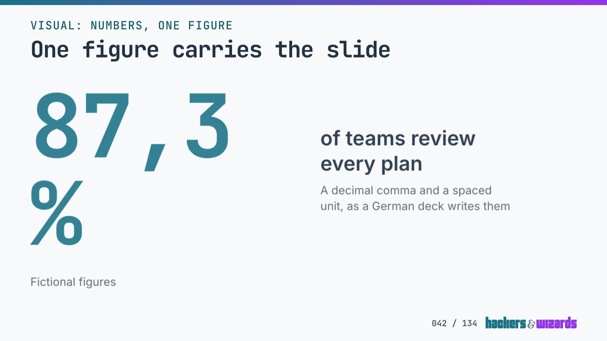
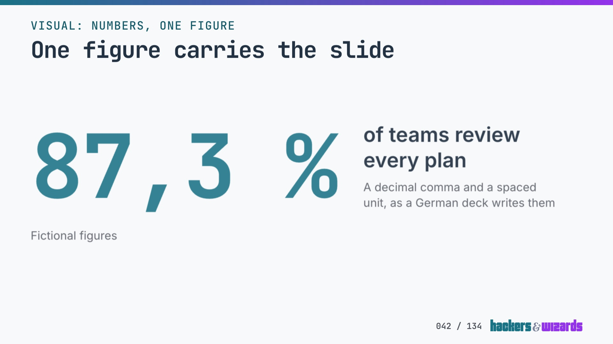

# A lone figure broke before its unit, 11.11.2026

The catalog state "Visual numbers one" drew "87,3 %" as "87,3" with "%" alone on the line below.
No commit or test chose that wrap. Slides v3.6.1 and v3.6.2 keep a figure and its unit on one
line, in a numbers block and in a timeline.

## Cause

On the stage a lone figure stands in a flex row beside its label. As a flex item it may shrink
down to its narrowest width, and the space between "87,3" and "%" lets it break. The row squeezed
the figure to 832 px at 1920, so "%" moved to a second line. Each grid figure already carried
`whitespace-nowrap`; the lone figure never did.

Measured in Chrome for Testing on the built story, the figure at 13rem:

| Width | As shipped                 | U+00A0 or `nowrap`, each alone |
| ----- | -------------------------- | ------------------------------ |
| 1920  | 2 lines, 832 px, label 811 | 1 line, 957 px, label 686      |
| 1440  | 2 lines, 624 px            | 1 line, 718 px                 |
| 1280  | 2 lines, 555 px            | 1 line, 638 px                 |
| 390   | 1 line, 335 px             | 1 line                         |

A timeline's figure has the same break: with a spaced unit, "−90 %" needs 355 px of a 286 px
column on a phone and wraps. The specimen writes it unspaced, so the catalog never showed it.

## What changed

- Every figure of a numbers block or a timeline carries `whitespace-nowrap`.
- A lone figure on the stage is sized like the grid's figures: at most `--slide-figure-hero`, and
  small enough to take two thirds of its row, so a long one cannot push its label past the slide.
  "87,3 %" stays at 13rem (957 px at 1920), as before.
- A lone figure's label takes the room left beside the figure, and stands below it where its
  longest word finds none. Without that, "Mitarbeiterzufriedenheit" beside "87,3 %" ran 70 px
  past its row into the slide's margin once the figure could no longer wrap.
- A timeline figure gets, at every width, the `cqi` cap the numbers figures have on a phone. With
  five stages a column is 270 px at 1920: "−90 %" lands at 90 px there, 250 px of text. Only an
  event body holding a figure is a size container (v3.6.2): on a centred slide, v3.6.1 made every
  body one and drew a timeline's columns 8 px narrower (561 against 569 px at 1920).

Where each length lands, measured on the built story, one line each:

| Value                | 1920                           | 390     |
| -------------------- | ------------------------------ | ------- |
| "87,3 %"             | 277 px, label 686 px           | 97.2 px |
| "12.345 %"           | 229 px (10.7rem), label 589 px | 72.9 px |
| "1.234.567 €"        | 167 px (7.8rem), label 589 px  | 53.0 px |
| "up to 12.345.678 €" | 118 px, label 634 px           | 37.6 px |
| "−90 %", segments    | 171 px, unchanged              | 95.3 px |

Without the stage size, "1.234.567 €" beside the label "Umsatz" ran 1754 px of figure into a
1728 px row and pushed its label past it, where the fit guard, which shrinks only for height,
never acts. The two thirds are a judgement, not a measurement: they keep "87,3 %" at 13rem and leave
a label about 590 px.
The four numbers stories and three timeline stories, shot at 1920 and some at 1440 and 390, are
pixel-identical before and after these two sizes and the label change, apart from two shots that
also differ between two shots of one build.

The PDF, printed from `PrintSlide` with `renderPdf`, read "87,3" and "%" four lines apart before
the change and "87,3 %" on one line after it; the same for "12.345 %".

PowerPoint never broke a figure, and `slides-pptx` is unchanged. It draws a numbers block only at
the body's full width, and `numbersGrid` sizes each figure to its column. Measured with `wrap` from
`scripts/pptx-text.ts`, 20 figures each take one line: one, two, four and six figures up to
"up to 12.345 %", and both specimen timelines with "-90 %" and "-40 %". The tightest is 1.67 in of
text in a 1.88 in box. The same `wrap` breaks "87,3 %" in a 3.0 in box. A figure's box is one line
high, so a wrapped figure warns as text taller than its box: with figures set 1.6 times too large,
the specimen run warns "text 2.79 in tall in a box 1.40 in".

## One specimen change

On a phone the specimen's timeline figures "−90%" and "−40%" shrink from 128 px to 119.2 px. They
fit before, 284.2 px of text in a 286 px column; the cap's estimate of 0.6em a character is
cautious. Blind review, small: one persona (a client's team lead reading the deck on a phone),
Codex, one run, current and new under neutral labels in mixed order. New scored 46 against 42 on
both slides, five criteria of 10: "B's percent sign presses toward the edge". Noise not measured.
The prompt, verbatim:

> You are a team lead at a client company. A consultant shared a slide deck link with you, and you
> are reading it on your phone (a 390 px wide screen, shown here at 2x resolution, 780 px wide).
> Each image is the lower part of one slide: a vertical timeline whose last step ends in a large
> result figure.
>
> Images A and B show one slide in two versions. Images C and D show another slide in two
> versions.
>
> Score each image from 1 to 10 on each criterion:
>
> 1. The result figure is easy to read at a glance.
> 2. Nothing looks cut off, crammed against the screen edge or out of line with the text above it.
> 3. Breathing room, not cramped.
> 4. Visual calm.
> 5. The figure reads as the result of the step above it.
>
> Then, per pair (A/B and C/D), say which version you would rather read and why, in at most two
> sentences, and name anything that keeps a criterion below 10.

## Tests

`test/pages/line-breaks.test.ts` checks every figure of a numbers block or timeline for a second
line and for standing past its row: `frames.html` in print at 1920, and the four numbers stories
and two timeline stories at 1920, 1440 and 390 px. Without the change it fails in print, at 1920
and at 1440; without the stage size, "1.234.567 €" beside "Umsatz" fails at 1920 and 1440. The
timeline part guards only: no specimen timeline has a spaced unit, so it passes without the change
too. `test/render-pptx.test.ts` renders "12.345 %" in one, two, four and six figures and fails on
any warning.

## Left open

Closed in v3.7.0 (`2026-11-11-figure-review.md`): the gate holds the long values, the label below
its figure and a spaced timeline figure, and notices a timeline figure without its cap; a blind
review kept the stage size and the label below its figure; a phone label of one long word stays
inside its row; `slides-pptx` writes a timeline figure's minus. Still open:

- `/simplify` proposes capping the lone figure in `cqi` on the stage too, as the timeline, instead of
  the rem size. It would put size containment on the numbers row at every width, which e5291b2
  kept off the stage.
- The lone figure's stage size, like `numbersGrid`, writes the stage's 1650 px row and its rem of
  21.333 px as numbers rather than reading them from brand.
- `slides-pptx` draws a lone figure as a one-column grid at 7rem with its label below, where the
  web sets it beside its label.
