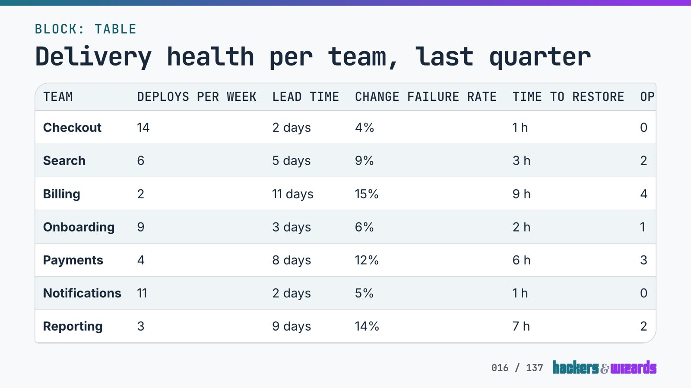
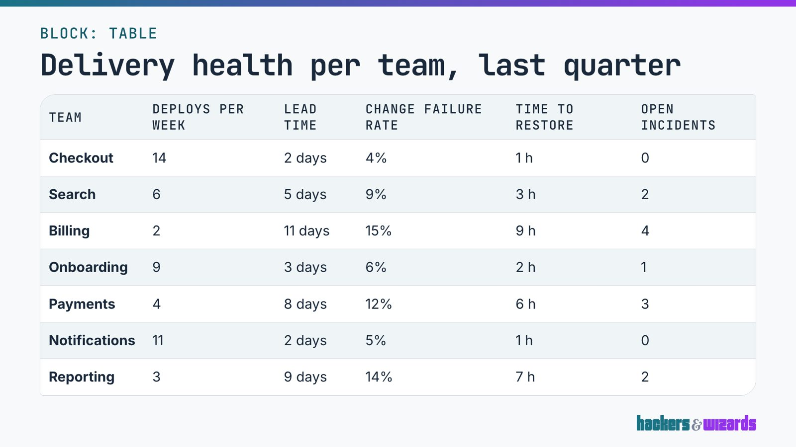
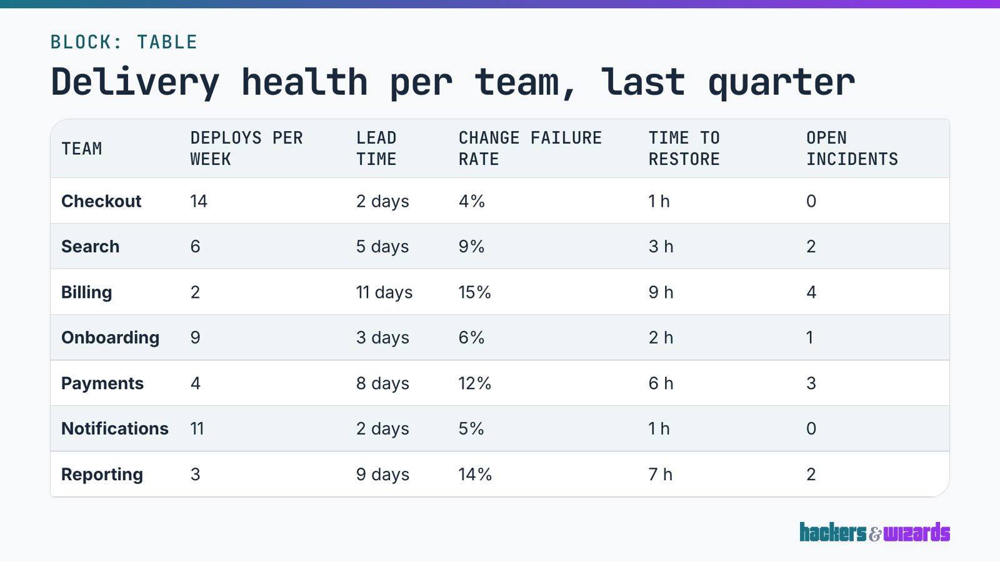

# The slide table's column heads stay as they are, 12.11.2026

A blind review scored the current column heads against two larger ones. Neither led outside the
noise for every reviewer, so nothing changed. The variant the brief named, larger, unspaced and on
one line, cannot be built for a wide table: six heads on one line run out of the table at any label
size the slide offers.

## Who owns what

The heads are brand's label element (`hw-label`) inside the `slide-table` exception. The engine sets
their size through the element's `--hw-label-size` (`text-base` in a compact table, `text-lg` in a
full one) and lets them wrap. Their tracking is brand's label role (`--type-label-tracking`,
0.06em), with no setting of the element's own. A change of size or wrapping is the engine's; a
change of tracking is brand's, so an unspaced head would go to brand as a work item. No item went
to brand, since the review found no lead to brief.

## Unwrapped heads do not fit a wide table

The 12.11. stripe review's dense table, seven teams by six columns, with every head on one line. The
table's width at 1920 × 1080 against its frame's, 1803 px as this slide lays it out:

| Head size            | Brand tracking | No tracking |
| -------------------- | -------------- | ----------- |
| `text-sm`, 26.7 px   | 1804           | 1804        |
| `text-base`, 32.0 px | 2017           | 1877        |
| `text-lg`, 34.7 px   | 2145           | 1994        |
| `text-xl`, 36.0 px   | 2210           | 2052        |

Every row overflows, by 1 px at the smallest size and by up to 407 px at the largest. Why the
smallest size measures the same with and without tracking was not established. The fit guard shrinks a slide for height only, so a slide with such a table shows its
last column cut off:
. The panel therefore
scored wrapping heads.

## What was compared

- **A**, the heads as they are: `text-base` in a compact table, `text-lg` in a full one.
- **B**, one step larger: `text-lg` and `text-xl`. A change the engine owns.
- **C**, B without the label's tracking (`letter-spacing: 0`). A mock of a brand change.

Two slides, shot on the catalog's table story at 1920 × 1080 from a scratch worktree of `6e3751b`:
the specimen's table slide (a three-row table with heads and a compact one without) and the dense
table above, whose six heads wrap to two lines. The page counter was painted out. Each shot also
went through the stripe review's two simulated views, with its parameters unchanged: _lit room_
(CSS `contrast(0.6) brightness(1.2) blur(0.5px)`) and _720p stream_ (scaled to 1280 × 720, JPEG
quality 50).

| A                                                           | B                                                        | C                                                                           |
| ----------------------------------------------------------- | -------------------------------------------------------- | --------------------------------------------------------------------------- |
|  |  |  |

## Method

- **Personas**, the stripe review's two: _room_, a software engineering lead in the fifth row of a lit
  seminar room, about 8 m from a 2.5 m projection; _stream_, an engineering manager following a
  talk over a 720p stream on a 14-inch laptop while taking notes.
- **Runs.** Each persona by Claude (`claude-opus-5-5`, effort medium) and Codex (`gpt-6.1-sol`,
  effort high), two runs each: eight calls. Each saw both slides in all three versions, as the full
  shot and its persona's view, at full resolution.
- **Blinding.** Versions labelled 1 to 3, their order and the slides' order drawn at random per
  call.
- **Criteria**, of 10 each, fixed before any score: column heads, cells, visual calm, ours and
  overall.
- **Decision rule**, written before any output was read: a variant ships only where it leads A
  outside the noise for every reviewer; C ships only through brand.

The prompt of the room persona's first Codex run, verbatim but for the image list, which named the
twelve images by absolute path in the scratch folder, `slide-<n>_version-<n>_full.png` and
`_view.png` for each slide and version:

> You are a software engineering lead attending a two-day in-person workshop. You sit in the fifth
> row of a seminar room with the ceiling lights on and daylight from the windows. The slides come
> from a projector onto a screen about 2.5 m wide, roughly 8 m from you.
>
> You are shown two table slides from a training deck, each in three versions (version 1, version
> 2 and version 3). The medium is a 16:9 presentation slide (1920x1080). For each slide and version
> you get two images: "full" is the slide rendered at full size, and "view" is a simulation of the
> same slide as it reaches you projected in that lit room (washed-out contrast, slightly soft).
> Judge each version as it reaches you in your situation; use the full-size image only to check
> detail.
>
> Score each version from 1 to 10 on each criterion, taking both slides together:
>
> 1. Column heads: how easily you read the column heads in your situation.
> 2. Cells: how easily you read the cells in your situation.
> 3. Visual calm: breathing room, not cramped, nothing competing with the content.
> 4. Ours: looks made for this company and of a piece with the rest of the slide (top strip,
>    heading, logo).
> 5. Overall: which you would rather see on the screen.
>
> Then, for each version and criterion below 10, say in one line what keeps it below 10. Then name
> the version you prefer and why in two sentences.
>
> Answer in exactly this shape: SCORES / version 1: heads=... cells=... calm=... ours=...
> overall=... / version 2: ... / version 3: ... / BELOW 10 / ... / PREFERENCE / ...

## Scores

Unblinded, heads, cells, calm, ours and overall, with the sum out of 50:

| Run               | A         | Sum | B         | Sum | C         | Sum |
| ----------------- | --------- | --- | --------- | --- | --------- | --- |
| room, Claude, 1   | 6 9 8 8 6 | 37  | 8 9 7 8 8 | 40  | 7 9 8 8 7 | 39  |
| room, Claude, 2   | 6 9 8 8 6 | 37  | 7 9 7 8 7 | 38  | 8 9 8 8 8 | 41  |
| room, Codex, 1    | 7 8 8 9 8 | 40  | 8 8 8 9 8 | 41  | 9 8 8 9 9 | 43  |
| room, Codex, 2    | 7 8 8 9 8 | 40  | 9 8 8 9 9 | 43  | 8 8 8 9 8 | 41  |
| stream, Claude, 1 | 8 9 9 8 9 | 43  | 7 9 7 8 7 | 38  | 7 9 7 7 7 | 37  |
| stream, Claude, 2 | 7 9 8 9 7 | 40  | 8 9 8 8 7 | 40  | 9 9 8 8 8 | 42  |
| stream, Codex, 1  | 8 8 9 9 8 | 42  | 8 8 8 9 8 | 41  | 9 8 8 9 9 | 43  |
| stream, Codex, 2  | 8 9 9 9 8 | 43  | 8 9 8 9 8 | 42  | 9 9 8 9 9 | 44  |

Per reviewer, the mean lead over A against the noise, the larger spread of the two versions' sums
between a reviewer's two runs:

| Reviewer       | Lead of B | Noise | Lead of C | Noise |
| -------------- | --------- | ----- | --------- | ----- |
| room, Claude   | 2.0       | 2     | 3.0       | 2     |
| room, Codex    | 2.0       | 2     | 2.0       | 2     |
| stream, Claude | -2.5      | 3     | -2.0      | 5     |
| stream, Codex  | -1.0      | 1     | 1.0       | 1     |

C leads outside the noise for one reviewer of four, B for none. On the heads criterion alone the
larger heads do better: A scored 6 to 8, B 7 to 9 and C 7 to 9, C above A in seven of eight runs.
The reviewers split on the tracking: two runs found the spaced capitals blur into grey blocks from a
distance, one found the spacing the only thing that kept them readable. Several runs marked the
larger heads down for calm, since six two-line heads make a taller head band.

## Left open

- The heads still wrap in a wide table. Shorter heads are the deck's choice.
- The panel scored projected and streamed slides only, not night slides or the PowerPoint export.

Review: medium, because the change would reach every table slide in three consumers.
