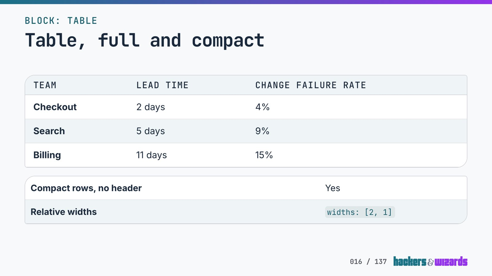
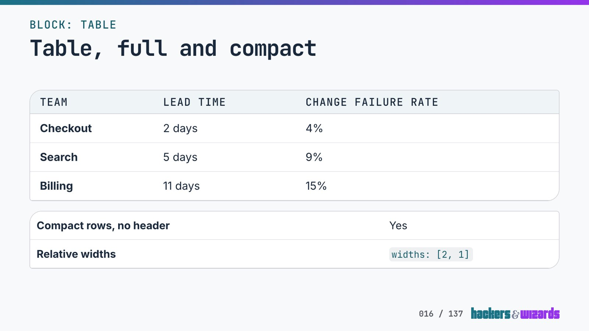
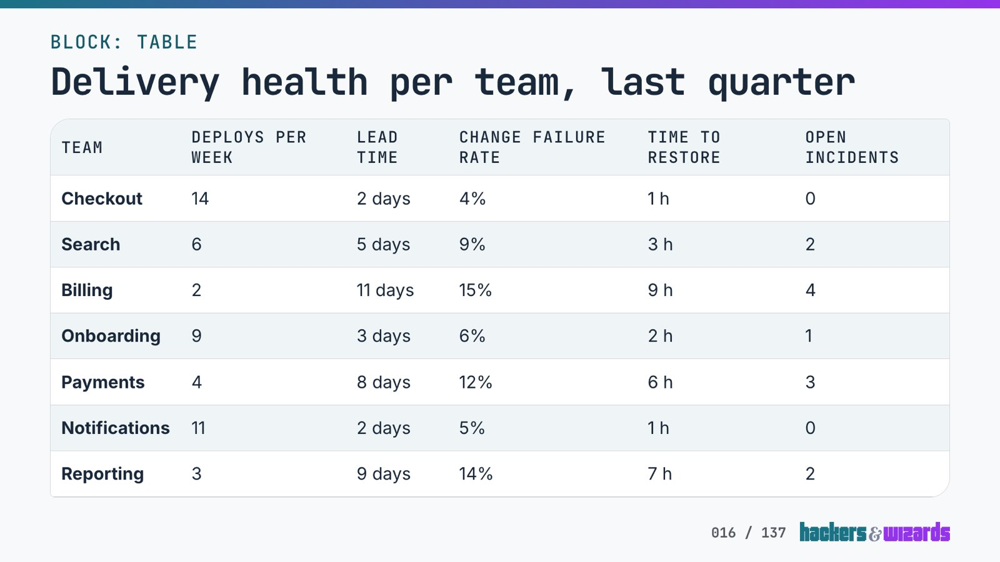
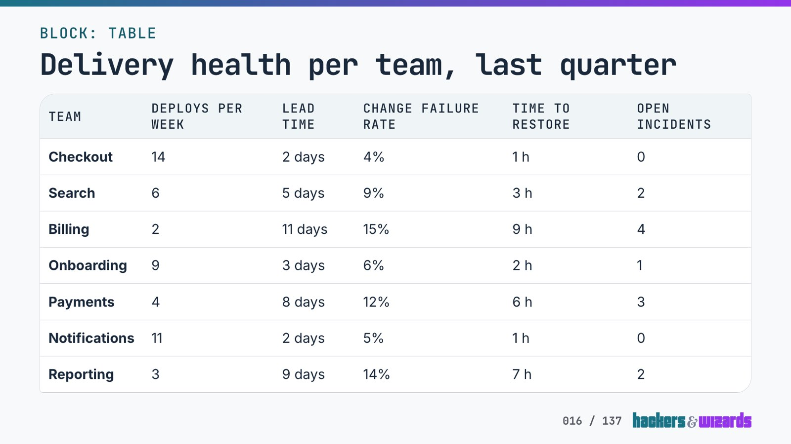
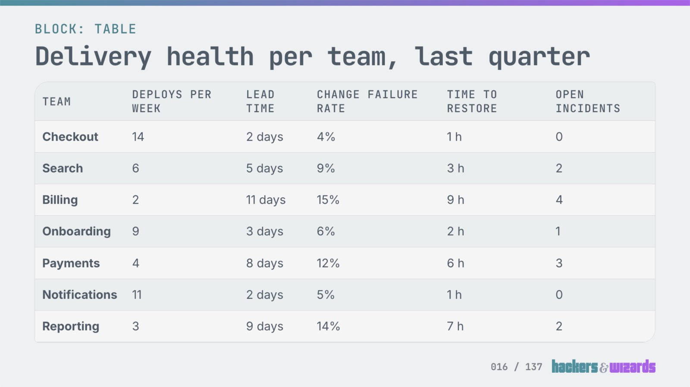
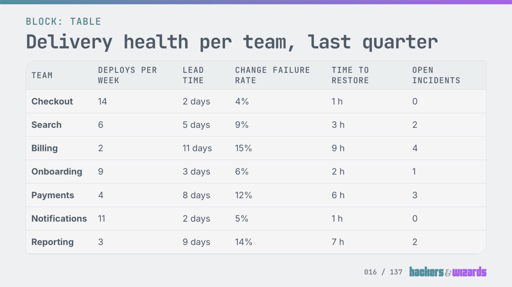
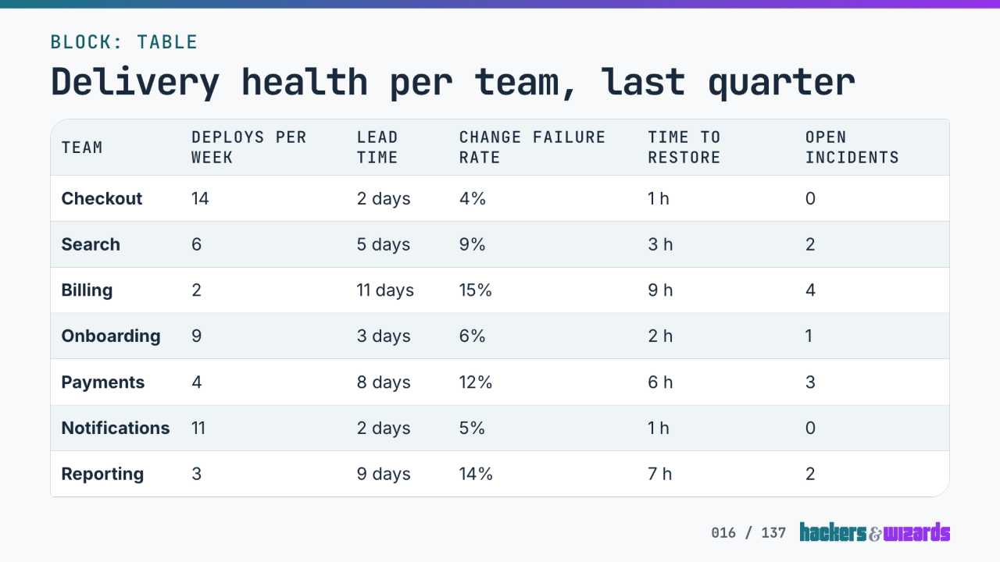
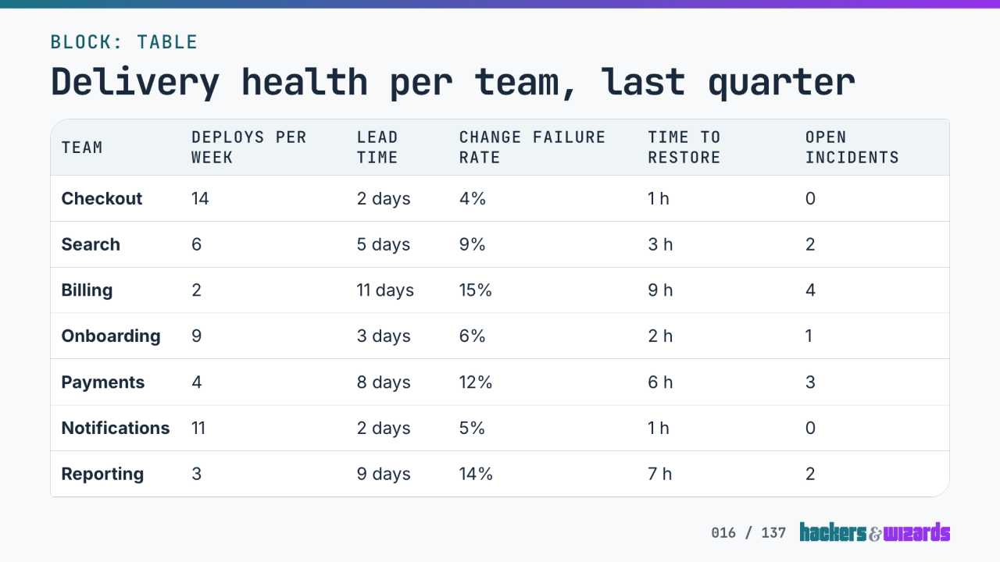

# The slide table keeps its stripes, 12.11.2026

A blind review preferred the slide table with every second body row tinted over the same table with
hairlines alone, in all eight runs, with both models and both personas. The stripes stay. The
`slide-table` exception in `brand-elements.json` now names them and this review, and
`test/table-and-sketch.test.tsx` fails once a body row loses its tint (red against B, green against A). Nothing that ships changed,
so no release followed.

## What was compared

Brand's table (`hw-table`) draws a hairline under each row, with no fill and no frame. The slide
table draws the same hairlines, a tinted head row, every second body row in `bg-primary/7`, the
hovered row in the same tint, all in a framed white box. The stripes came with the engine's first
commit, and no earlier review chose them.

- **A**, the slide table as it is.
- **B**, A without the tint on every second body row. The head row's tint, the hovered row's tint,
  the frame and the hairlines stay, so the one rule under test differs.

Two slides, each shot on its catalog story page at 1920 × 1080 from a scratch worktree of
`2c4db48`:

- The specimen's table slide ("Table, full and compact"): a three-row table with heads and a
  two-row compact table without them.
- A denser fictional slide, made for this review and not committed: a compact table of seven teams
  and six columns ("Delivery health per team, last quarter"). The specimen's tables of two and
  three rows barely ask a reader to track a row. Its whole content shows in the images below.

Each 1920 shot was turned into two simulated views. The parameters were fixed before any pair was
looked at and applied to every shot alike:

- **Projector in a lit room:** CSS `contrast(0.6) brightness(1.2) blur(0.5px)` over the shot.
  Black reaches about 24 % grey and white about 96 %. The numbers are a judgement, not a
  measurement of a projector.
- **720p stream:** the shot scaled to 1280 × 720 and saved as JPEG at quality 50.

No pair of A and B shots is pixel-identical. The reviewers saw the shots at full resolution; the
copies here are JPEGs at 1600 px.

|                                | A                                                                     | B                                                                     |
| ------------------------------ | --------------------------------------------------------------------- | --------------------------------------------------------------------- |
| Specimen, full                 |           |           |
| Dense, full                    |                 |                 |
| Dense, lit room (simulated)    |  |  |
| Dense, 720p stream (simulated) |        |        |

## Method

- **Personas.** Two, from the audience that reads these slides in a lit room or over a stream:
  - _room_: a software engineering lead in the fifth row of a lit seminar room, about 8 m from a
    2.5 m projection.
  - _stream_: an engineering manager following a talk over a 720p stream on a 14-inch laptop while
    taking notes.
- **Runs.** Each persona was scored by Claude (`claude-opus-5-5`, effort medium) and Codex
  (`gpt-6.1-sol`, effort high), two runs each: eight calls.
- **Images.** Each call saw both slides in both versions, as the full 1920 shot and its persona's
  simulated view, at full resolution.
- **Blinding.** Versions were labelled "version 1" and "version 2" in file names and prompt. Which
  of A and B took which label, and which slide came first, were drawn at random per call.
- **Criteria.** Five, of 10 each, fixed before any score: row tracking, legibility, visual calm,
  ours and overall.
- **Decision rule.** Written down before any output was read. The stripes are the exception to
  brand's table, so A stays only where it leads B outside the noise in both runs, with both models.
  Any other result goes to B, the variant with fewer exceptions.

The prompt of the room persona's first Claude run, verbatim (the image paths name the scratch
folder):

> You are a software engineering lead attending a two-day in-person workshop. You sit in the fifth
> row of a seminar room with the ceiling lights on and daylight from the windows. The slides come
> from a projector onto a screen about 2.5 m wide, roughly 8 m from you.
>
> You are shown two table slides from a training deck, each in two versions (version 1 and version
> 2). The medium is a 16:9 presentation slide (1920x1080). For each slide and version you get two
> images: "full" is the slide rendered at full size, and "view" is a simulation of the same slide as
> it reaches you projected in that lit room (washed-out contrast, slightly soft). Judge each version
> as it reaches you in your situation; use the full-size image only to check detail.
>
> Images (absolute paths):
>
> - .../panel/room-claude-1/slide-1_version-1_full.png
> - .../panel/room-claude-1/slide-1_version-1_view.png
> - .../panel/room-claude-1/slide-1_version-2_full.png
> - .../panel/room-claude-1/slide-1_version-2_view.png
> - .../panel/room-claude-1/slide-2_version-1_full.png
> - .../panel/room-claude-1/slide-2_version-1_view.png
> - .../panel/room-claude-1/slide-2_version-2_full.png
> - .../panel/room-claude-1/slide-2_version-2_view.png
>
> Score each version from 1 to 10 on each criterion, taking both slides together:
>
> 1. Row tracking: how easily you follow one row's values across all columns without losing the line.
> 2. Legibility: how easily you read the cells and the column heads in your situation.
> 3. Visual calm: breathing room, not cramped, nothing competing with the content.
> 4. Ours: looks made for this company and of a piece with the rest of the slide (top strip, heading, logo).
> 5. Overall: which you would rather see on the screen.
>
> Then, for each version and criterion below 10, say in one line what keeps it below 10. Then name
> the version you prefer and why in two sentences.
>
> Answer in exactly this shape: SCORES / version 1: row=... legibility=... calm=... ours=... overall=... /
> version 2: ... / BELOW 10 / ... / PREFERENCE / ...

## Scores

Unblinded, row, legibility, calm, ours and overall, with the sum out of 50:

| Run               | A         | Sum A | B         | Sum B | Lead of A |
| ----------------- | --------- | ----- | --------- | ----- | --------- |
| room, Claude, 1   | 8 8 8 8 8 | 40    | 7 8 8 8 7 | 38    | 2         |
| room, Claude, 2   | 8 8 8 8 8 | 40    | 6 8 8 7 7 | 36    | 4         |
| room, Codex, 1    | 8 7 9 8 8 | 40    | 6 7 9 8 7 | 37    | 3         |
| room, Codex, 2    | 8 7 9 8 8 | 40    | 6 7 9 8 7 | 37    | 3         |
| stream, Claude, 1 | 9 8 8 8 8 | 41    | 7 8 8 8 7 | 38    | 3         |
| stream, Claude, 2 | 9 8 8 8 9 | 42    | 7 8 9 8 7 | 39    | 3         |
| stream, Codex, 1  | 9 8 9 8 9 | 43    | 6 8 9 8 7 | 38    | 5         |
| stream, Codex, 2  | 9 8 9 8 9 | 43    | 7 8 9 8 8 | 40    | 3         |

Noise is the spread of one reviewer's sum between its two runs:

| Reviewer       | Mean lead of A | Noise A | Noise B |
| -------------- | -------------- | ------- | ------- |
| room, Claude   | 3.0            | 0       | 2       |
| room, Codex    | 3.0            | 0       | 0       |
| stream, Claude | 3.0            | 1       | 1       |
| stream, Codex  | 4.0            | 0       | 2       |

A leads in every run, by 2 to 5 points, and every run prefers A. Read per reviewer, each mean lead
(3 to 4) stands above that reviewer's noise (at most 2), so the decision rule keeps A. Read per run,
seven of the eight leads stand above their reviewer's noise, and one equals it: room, Claude, run 1,
a lead of 2 at a noise of 2 for B. The rule as written does not say which reading it means; this
report takes the per-reviewer one, as the `blind-review` skill's example of a lead against its noise
does.

The lead lies in row tracking (1 to 3 points in every run) and overall (1 to 2). Legibility is
level in all eight runs and ours in seven. Calm is level in seven, with B one point ahead in one
Claude stream run.

Every run points to the dense table as the slide that decides. On the specimen's short tables the
reviewers found the two versions nearly alike, and two Codex runs counted the tint on those short
tables as a little visual activity. The reasons against B repeat in every run: the hairline fades
in the washed-out projection or the compressed stream, and the eye slips a row across the wide gap
between the team name and the far columns.

## Inline code

`lib/markdown.tsx` sets inline code in `text-teal-dark`, since base teal on the chip over a striped
row falls under 4.5:1. That still holds. Measured on the chip's 7 % ink over the ground, base teal
reaches 4.85:1 on a white row and 4.42:1 on a tinted one, and teal-dark reaches 6.72 and 6.12.

## Left open

- The projector and the stream are simulations, and their parameters are a judgement. A real
  projector or stream was not measured.
- Night slides were not shot.
- In all eight runs the reviewers marked the column heads down for legibility: small, letterspaced
  mono capitals that wrap onto two lines and wash out in the projected view. That is outside this
  review and was not changed.
- The PowerPoint export (`scripts/render-pptx.ts`) draws its tables with a tinted head and untinted
  body rows, though its comment calls them the web's table. Work item `work-pptx-table-stripe`
  carries it.

Review: medium, because the change would reach every table slide in three consumers.
