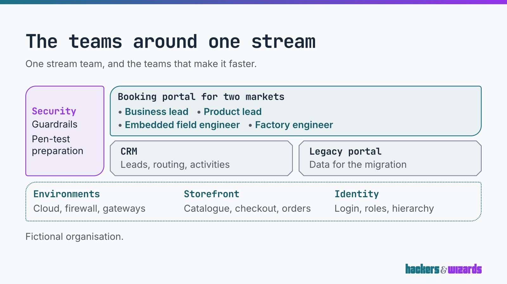
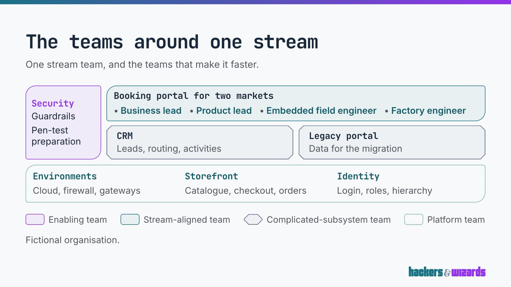
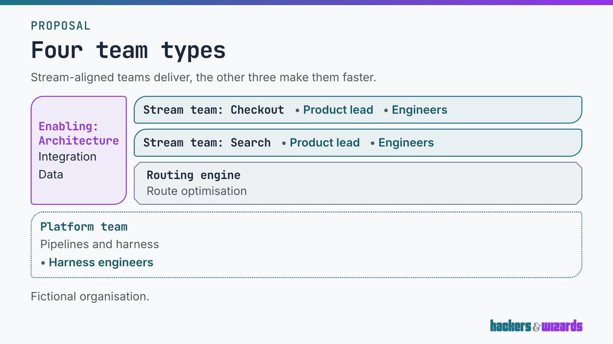
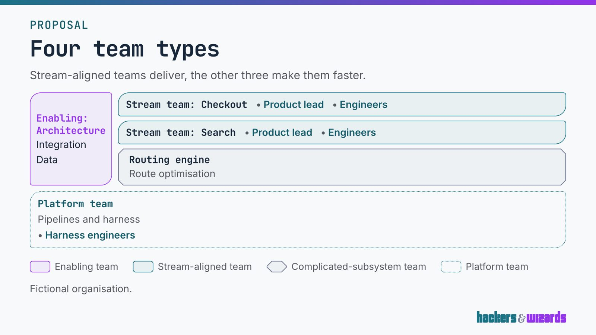

# The team-topology slide draws its legend by default, 12.11.2026

A blind panel of readers new to Team Topologies preferred the team picture with its legend in all
eight runs. With the legend every reader named the type of each team asked about; without it every
reader answered "cannot tell". The legend is now on unless a slide sets `legend: false`, in the web
component and in `slides-pptx`.

## What the legend costs

The fit guard's factor at 1920 × 1080, read on the story pages, with the legend off and on:

| Slide                                                | Off   | On    |
| ---------------------------------------------------- | ----- | ----- |
| Specimen: two streams, a subsystem, caption          | 1     | 0.884 |
| Specimen: minimal                                    | 1     | 1     |
| Specimen: full proposal, every team type             | 1     | 0.950 |
| Specimen: the same picture, names without their type | 1     | 0.950 |
| The densest test fixture                             | 0.685 | 0.655 |
| A consumer's slide, first                            | 0.940 | 0.913 |
| A consumer's slide, second                           | 1     | 1     |
| A consumer's slide, third                            | 0.815 | 0.769 |

`slides-density` lists a slide below 0.9 and fails one below 0.8. The legend costs one row. No
specimen slide falls under 0.8, so the density run over the specimen deck stays green. One of the
consumer's three slides falls from 0.815 to 0.769: that deck needs `legend: false` on that slide or
less on it, and the release commit says so.

## What was compared

- **Without:** the slide as a deck without `legend` drew it until now.
- **With:** the same slide with its legend row.

Two slides, each in both versions, shot on their story pages at 1920 × 1080. The page counter was
painted out of all four, since it gave the slide's place in the specimen deck.

- _Stream_: "The teams around one stream", whose team names carry no type ("Security", "CRM").
- _Types_: "Four team types", whose names carry their type ("Enabling: Architecture").

|        | Without                                                                | With                                                             |
| ------ | ---------------------------------------------------------------------- | ---------------------------------------------------------------- |
| Stream |  |  |
| Types  |    |    |

## Method

- **Personas.** Two readers who have never heard of Team Topologies:
  - _room_: the head of a business department at a leadership talk, 6 m from a 2.5 m projection in a
    lit seminar room.
  - _pdf_: a product manager reading the deck as a PDF on a 14-inch laptop the day after a workshop,
    with nobody to ask.
- **Runs.** Each persona by Claude (`claude-opus-5-5`, effort medium) and Codex (`gpt-6.1-sol`,
  effort high), two runs each: eight calls.
- **Blinding.** Versions labelled "version 1" and "version 2"; which one took which label, and which
  slide came first, drawn at random per call. In three calls of the first round the label was drawn
  per slide, so one label held the legend on one slide and none on the other; those three calls were
  run again with one draw per call, and only the valid eight are counted.
- **Criteria**, of 10 each, fixed before any score: understanding, legibility, visual calm, ours and
  overall. Before scoring, each reviewer named the type of three teams on the _stream_ slide from the
  slide alone.
- **Decision rule**, written before any output was read: the default changes only where the legend
  leads outside the noise for every reviewer.

The prompt of the room persona's second Claude run, verbatim (the image paths name the scratch
folder):

> You are the head of a business department at a mid-sized company, with no software background.
> You attend a 30-minute leadership talk in a seminar room with the lights on; the slides come from
> a projector onto a screen about 2.5 m wide, roughly 6 m from you. You have never heard of "Team
> Topologies" and its team types.
>
> You are shown two slides from a presentation deck, each in two versions (version 1 and version 2).
> The medium is a 16:9 presentation slide, rendered here at 1920x1080; judge each as it reaches you
> in your situation.
>
> Images (absolute paths):
>
> - .../room-claude-2/slide-1_version-1.png
> - .../room-claude-2/slide-1_version-2.png
> - .../room-claude-2/slide-2_version-1.png
> - .../room-claude-2/slide-2_version-2.png
>
> First, a task from the slides alone, without outside knowledge: for slide 2, in each version, say
> what kind of team "Security", "CRM" and "Environments" each are, as the slide tells you, or write
> "cannot tell".
>
> Then score each version from 1 to 10 on each criterion, taking both slides together:
>
> 1. Understanding: how well you can tell, from the slide alone, what kind of team each box is and
>    how the kinds differ.
> 2. Legibility: how easily you read every text on the slide in your situation.
> 3. Visual calm: breathing room, not cramped, nothing competing with the content.
> 4. Ours: looks made for this company and of a piece with the rest of the slide (top strip,
>    heading, logo).
> 5. Overall: which you would rather see.
>
> Then, for each version and criterion below 10, say in one line what keeps it below 10. Then name
> the version you prefer and why in two sentences.
>
> Answer in exactly this shape: TASK / version 1: Security=... CRM=... Environments=... / version 2:
> ... / SCORES / version 1: understanding=... legibility=... calm=... ours=... overall=... / version
> 2: ... / BELOW 10 / ... / PREFERENCE / ...

## Scores

Unblinded, understanding, legibility, calm, ours and overall, with the sum out of 50:

| Run             | With      | Sum | Without   | Sum | Lead |
| --------------- | --------- | --- | --------- | --- | ---- |
| room, Claude, 1 | 8 7 7 8 8 | 38  | 3 8 8 8 5 | 32  | 6    |
| room, Claude, 2 | 9 7 7 8 8 | 39  | 4 8 8 9 5 | 34  | 5    |
| room, Codex, 1  | 7 6 7 9 7 | 36  | 3 8 8 9 6 | 34  | 2    |
| room, Codex, 2  | 7 7 7 9 8 | 38  | 3 8 8 9 6 | 34  | 4    |
| pdf, Claude, 1  | 8 8 7 8 8 | 39  | 4 9 8 8 5 | 34  | 5    |
| pdf, Claude, 2  | 8 8 7 8 8 | 39  | 3 8 8 8 4 | 31  | 8    |
| pdf, Codex, 1   | 8 8 8 9 8 | 41  | 3 9 9 9 6 | 36  | 5    |
| pdf, Codex, 2   | 8 8 8 8 8 | 40  | 4 9 9 8 6 | 36  | 4    |

Noise is the spread of one reviewer's sum between its two runs:

| Reviewer     | Mean lead | Noise with | Noise without |
| ------------ | --------- | ---------- | ------------- |
| room, Claude | 5.5       | 1          | 2             |
| room, Codex  | 3.0       | 2          | 0             |
| pdf, Claude  | 6.5       | 0          | 3             |
| pdf, Codex   | 4.5       | 1          | 0             |

Every mean lead stands above its reviewer's noise, and every run prefers the legend. The lead lies in
understanding (4 to 5 points in every run) and overall (1 to 4). The legend costs up to a point of
legibility and of calm in most runs: the legend's text is smaller than the boxes', and the slide
shrinks a little to hold its row.

The task: with the legend, all eight runs named Security an enabling team, CRM a
complicated-subsystem team and Environments a platform team. Without it, all eight answered "cannot
tell" for all three.

## Left open

- Every run said the legend names the types without saying how they differ ("complicated-subsystem"
  stays a term). A sentence per type is the deck's job, in its subtitle or notes.
- Several runs found the dotted platform swatch faint at a distance. Not changed.
- The consumer slide that falls to 0.769 is the consumer's to settle.

Review: medium, because the default reaches every team-topology slide in three consumers.
