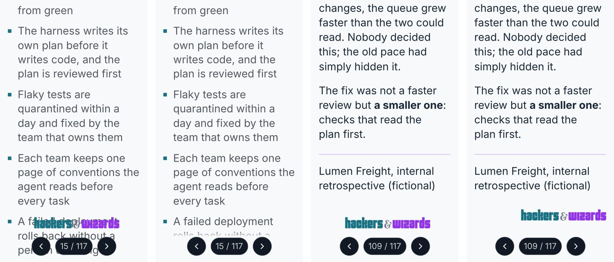
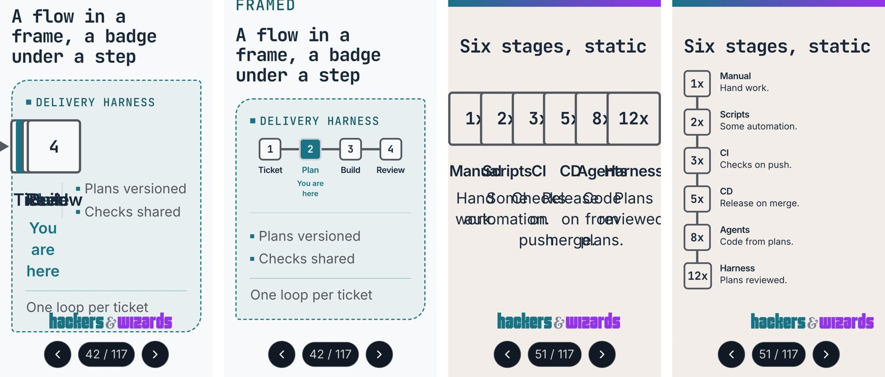

# Review: corner mark and step diagrams on a phone (v1.17.0)

Two phone defects in every deck, fixed in slides v1.17.0 after a blind panel. Look at the two
images; nothing needs an answer unless one of the choices looks wrong to you.

## What changed

- **Corner mark.** Below 48rem the corner row (and a deck's second logo) no longer stands fixed
  over the scrolling text. It follows the slide's content and appears where the content ends,
  above the player's buttons. Below 40rem the slide's ground fades in behind the buttons, so no
  line runs under them either.
- **Step diagrams.** A flow with up to four steps keeps its row on a phone, with smaller tiles and
  words. Five or more steps stand one under another, each tile beside its words. A framed flow's
  notes move under the steps, which take the frame's whole width.

Each image: before, after, before, after, on the fictional specimen deck at 375 px. The panel
judged the same variants on real talks and trainer-hub decks.

## How it was decided

Personas: a developer rereading a training deck on the train a week later, and an engineering
manager opening a talk's deck link in a break. Claude and Codex, each persona twice per round,
options shuffled under neutral letters, the current state among them unmarked. Criteria fixed
before scoring, 1 to 10 each. Noise is the mean spread of a reviewer's overall score between its
two runs.

Corner, round 1 (overall, mean of 8 runs; noise 0.50):

| Option                                | Overall |
| ------------------------------------- | ------- |
| Ground band behind corner and buttons | 7.38    |
| Corner after the content              | 7.00    |
| Corner at the top of the content      | 6.00    |
| Current (fixed over the text)         | 2.38    |

The top two were a tie inside the noise, and the models split. Every reviewer named the same cause
for both: the player's buttons still cover text mid-scroll. Round 2 added a variant combining the
corner after the content with a ground behind the buttons only.

Corner, round 2 (noise 0.44; both models agree):

| Option                                                        | Overall | Legibility | Calm | Room | Brand |
| ------------------------------------------------------------- | ------- | ---------- | ---- | ---- | ----- |
| Corner after the content, ground behind the buttons (shipped) | 8.88    | 8.50       | 9.00 | 8.25 | 6.25  |
| Ground band behind corner and buttons                         | 7.38    | 7.88       | 7.12 | 6.00 | 9.38  |
| Corner after the content                                      | 5.38    | 5.25       | 6.75 | 7.25 | 6.25  |
| Current                                                       | 2.25    | 2.38       | 2.50 | 3.25 | 6.00  |

Step diagrams, round 1, three and four steps (noise 0.17):

| Option        | Overall |
| ------------- | ------- |
| Compact row   | 6.88    |
| Vertical list | 6.12    |
| Current       | 1.50    |

Round 2, six stages (noise 0.25):

| Option        | Overall |
| ------------- | ------- |
| Vertical list | 9.00    |
| Compact row   | 4.75    |
| Current       | 1.12    |

The compact row broke six-stage titles mid-word, so the cut is at five steps. Five steps were not
in any panel: no deck has a five-step flow today.

One reviewer prompt, verbatim (round 1, corner):

> You are a software developer who took part in a two-day hands-on training. A week later you
> reread the training deck on your phone on the train to look something up. Medium: a slide deck
> opened as a web page in a phone browser, held upright. Display: a phone 375 to 412 CSS pixels
> wide; each screenshot is at 2x device pixels, which is its real size on that phone. Audience:
> you, reading alone. You compare 4 options (K, M, T, W) for how the deck's logo mark (and, in one
> deck, a second logo) is placed on each phone screen while you scroll through a slide. [...]
> Score each option from 1 (poor) to 10 (excellent) on each criterion: 1. legibility: every line
> of slide text can be read; nothing lies over it 2. brand: you can tell whose deck this is 3.
> calm: the screen looks calm, not busy 4. room: breathing room, not cramped 5. finish: looks
> intentional and finished 6. overall: the one you want while rereading

## Known limits

- Mid-scroll a long slide shows no logo (brand 6.25). The strip at the top carries the brand
  until it scrolls away.
- Two wide logos in one deck can still overlap on a 375 px row, as they did before. The real
  two-logo deck in the panel fit.
- A long flow's loop back is named under the last step ("↺ next test"), not drawn. Reviewers
  marked that down; no deck has a loop on five or more flow steps today.
