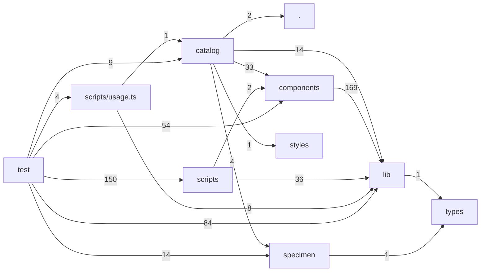

# Layers

## components

| Forbidden import                                                                      | Message                                                                                                                                                                                                                     |
| ------------------------------------------------------------------------------------- | --------------------------------------------------------------------------------------------------------------------------------------------------------------------------------------------------------------------------- |
| `^(?:(?:\.\./)+\|@hackersandwizards/slides/)(scripts\|catalog\|specimen\|test)(/\|$)` | `components/** cannot import from scripts/, catalog/, specimen/, or test/. Move shared logic or types into lib/ or types/, or pass deck and fixture data into the component via props. Do not silence with oxlint-disable.` |

## lib

| Forbidden import                                                                                       | Message                                                                                                                                                                                                                                                                                                    |
| ------------------------------------------------------------------------------------------------------ | ---------------------------------------------------------------------------------------------------------------------------------------------------------------------------------------------------------------------------------------------------------------------------------------------------------- |
| `^(?:(?:\.\./)+components(/\|$)\|@hackersandwizards/slides/(components(/\|$)\|lib/slide-components$))` | `lib/** cannot import from components/ or @hackersandwizards/slides/lib/slide-components. Keep UI-independent logic in lib/, move component rendering or mapping into components/ (such as components/slide-components.ts), or accept a component/callback parameter. Do not silence with oxlint-disable.` |
| `^(?:(?:\.\./)+\|@hackersandwizards/slides/)(scripts\|catalog\|specimen\|test)(/\|$)`                  | `lib/** cannot import from scripts/, catalog/, specimen/, or test/. Move shared pure logic, constants, or types into lib/ or types/ so scripts/, catalog/, specimen/, and test/ import from lib/. Do not silence with oxlint-disable.`                                                                     |

## scripts

| Forbidden import                                           | Message                                                                                                                                                                                                                                              |
| ---------------------------------------------------------- | ---------------------------------------------------------------------------------------------------------------------------------------------------------------------------------------------------------------------------------------------------- |
| `^(?:(?:\.\./)+\|@hackersandwizards/slides/)catalog(/\|$)` | `scripts/** cannot import from catalog/ (only scripts/usage.ts may import catalog/guidance). Move shared data or helpers out of catalog/ into lib/ or scripts/ so both scripts/ and catalog/ import them there. Do not silence with oxlint-disable.` |

## scripts/usage.ts

| Forbidden import                                                                                                                                                                                     | Message                                                                                                                                                                                                            |
| ---------------------------------------------------------------------------------------------------------------------------------------------------------------------------------------------------- | ------------------------------------------------------------------------------------------------------------------------------------------------------------------------------------------------------------------ |
| `^(?:(?:\.\./){2,}\|@hackersandwizards/slides/)catalog(/\|$)\|^\.\./catalog($\|/(.{0,7}\|.{9,}\|[^g].{7}\|.[^u].{6}\|..[^i].{5}\|...[^d].{4}\|....[^a]...\|.....[^n]..\|......[^c].\|.......[^e])$)` | `scripts/usage.ts may only import catalog/guidance from catalog/. Change the import to catalog/guidance, or move any other shared code out of catalog/ into lib/ or scripts/. Do not silence with oxlint-disable.` |

## types

| Forbidden import                                                                      | Message                                                                                                                                                                                                                                     |
| ------------------------------------------------------------------------------------- | ------------------------------------------------------------------------------------------------------------------------------------------------------------------------------------------------------------------------------------------- |
| `^(?:(?:\.\./)+\|@hackersandwizards/slides/)(lib\|components)(/\|$)`                  | ``types/** cannot import runtime values from lib/ or components/. Switch to a type-only import (`import type { ... }`), or move runtime helpers and constants into lib/ or components/. Do not silence with oxlint-disable.``               |
| `^(?:(?:\.\./)+\|@hackersandwizards/slides/)(scripts\|catalog\|specimen\|test)(/\|$)` | `types/** cannot import from scripts/, catalog/, specimen/, or test/. Declare shared type definitions in types/ (such as types/slide.ts) and import them from scripts/, catalog/, specimen/, or test/. Do not silence with oxlint-disable.` |
