# Slide-Katalog: Duplikate, Lücken und Programm

Stand 2026-11-01, Phase 1 von 4 (Analyse und Plan, keine Änderung an Engine oder Decks). Ziel und
Zeilen je Phase: [GOAL.md](../../GOAL.md). Entscheidungen: `docs/tracking/decisions/items.js`.

Benedikt am 01.11. (von Ada weitergegeben): «Wir scheinen da auch bei den Folien gerade ziemlich
viele Duplikate zu haben, also einfach Folientypen, die super ähnlich zueinander sind. Dafür
scheinen andere Folientypen vollständig zu fehlen.»

## Ergebnis

Das stimmt, in beide Richtungen. Sieben Gruppen von Typen und Blöcken machen fast dasselbe, und
sechs Kommunikationsaufgaben haben keinen Typ. Zusammengelegt wird aus 52 Einträgen (26 Typen, 26
Blöcke) 41. Mit Übung, Demo und Nächsten Schritten sind es 44, mit Vollbild und den zwei
Datendiagrammen bei Bedarf bis 47. Die Agenda als Zeitplan ist eine Variante und zählt nicht mit.

- **Duplikate:** Karten gibt es in fünf Formen, Vergleiche in vier, Abläufe in drei, die
  Deck-Übersicht in drei, Zahlen in zwei, die Textfolie in zwei, die Einzelaussage in zwei. Je
  Gruppe eine Zeile in `items.js` mit dem Ziel, das überlebt.
- **Fehlt:** eine Übungsfolie (56 Folien bauen sie von Hand), eine Agenda als Zeitplan (19), eine
  Demo-Folie, "Nächste Schritte" für Pitches und, nur bei Bedarf, ein Vollbild mit Text sowie ein
  Anteils- und ein Abweichungsdiagramm.
- **Kein Deck umgeht die Engine.** Alle 2.157 Folien in 52 Decks laufen über die 26 registrierten
  Typen. Was abweicht, sind Stellschrauben (Abschnittsfläche, Kartenfarbe) und Behelfe für die
  fehlenden Typen.
- **Gemaltes Bild:** Die Engine kann es (`image-and-grid` mit `sketch: true`), die Specimen-Seite
  zeigt es nicht. Bei sechs Sketches im trainer-hub fehlt das Flag, sie stehen gerahmt.
- **Team Topology** liegt mit 5,83 von 10 unter den schwächsten Typen. Sie zeichnet alle vier
  Teamarten als gleiche Kästen, das Subsystem-Team rot, und läuft ins Fußband.
- **Die Seite selbst** zeigt je Typ eine Kachel, zwei der 26 Blöcke und keine Variante. Wer eine
  Folie für einen Vergleich sucht, findet dort `comparison` `vs`, aber weder `two-column` noch
  `transform`, und keine Suche.

Plan: Phase 2 legt die Duplikate zusammen und optimiert die schwächsten und meistgenutzten
Einträge bis zum Plateau, Phase 3 baut die Katalogseite nach Kommunikationsaufgabe, Phase 4 stellt
jede Deckfolie um. Geschätzt 4 bis 6 Tage Wanduhr mit drei parallelen Sessions.

## Duplikate: was überlebt

Je Gruppe die Specimen-Folien nebeneinander, das Ziel mit Rahmen. "Deckfolien" zählt einmalige
Folien in talks, trainer-hub und hycle (Abschnitt "Bestand"). Wertung: Gesamt aus dem
Typen-Panel von tm- (os `docs/tracking/2026-11-01-title-closing-max.md`, eine Runde, zwei Läufe,
Rauschen 0,33), nur für Typen, Blöcke hat es nicht bewertet. Jedes Zusammenlegen gilt erst, wenn
die Zielform auf echten Deckfolien der aufgelösten Typen im Blind-Panel mindestens gleichauf liegt.

### 1. Karten: fünf Formen, Ziel `cards`

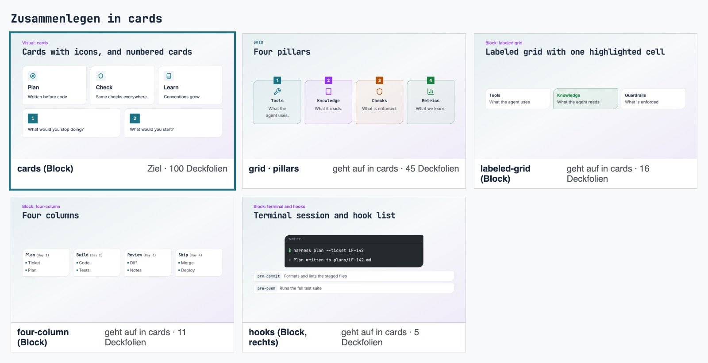

| Eintrag          | Deckfolien | Was anders ist                                                                |
| ---------------- | ---------: | ----------------------------------------------------------------------------- |
| `cards` (Ziel)   |        100 | Titel, Text, Icon oder Nummer                                                 |
| `grid` `pillars` |         45 | eigener Folientyp, farbige Nummernkacheln, Farbe je Karte (`accentColor`)     |
| `labeled-grid`   |         16 | Titel und Untertitel, eine Zelle hervorgehoben, Aufdecken Schritt für Schritt |
| `four-column`    |         11 | je Spalte eine Liste                                                          |
| `hooks`          |          5 | Name in Mono und Beschreibung, als Zeilen                                     |

`cards` gewinnt, weil es die meisten Folien trägt und zum Diagramm-Vokabular gehört, das schon
die Hervorhebung über einen Index regelt. Es braucht dafür `highlight`, eine optionale Liste je Karte
und das Aufdecken. `accentColor` fällt weg: Farbe kommt aus der Rolle, nicht je Karte.
`grid` bleibt danach nur mit `quotes` (2 Folien). Ob die Zitate in `statement` `quote` aufgehen,
prüft Phase 2 mit. Zeile `merge-cards`.

### 2. Vergleich: vier Formen, Ziel `comparison`

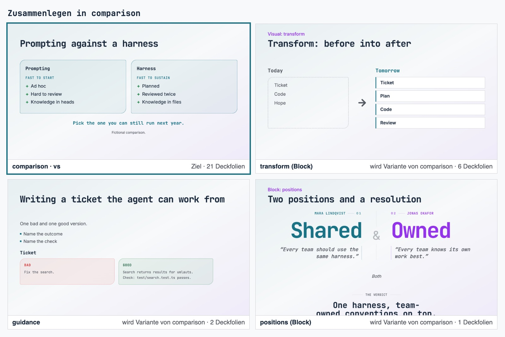

| Eintrag             | Deckfolien | Wertung | Was anders ist                                               |
| ------------------- | ---------: | ------: | ------------------------------------------------------------ |
| `comparison` (Ziel) |         21 |         | zwei Seiten, Pointe, Varianten `vs`, `before-after`, `split` |
| `transform`         |          6 |         | Vorher und Nachher mit Pfeil, dasselbe wie `before-after`    |
| `guidance`          |          2 |    6,50 | Beispiele schlecht und gut, auch als Code                    |
| `positions`         |          1 |         | zwei benannte Haltungen mit Zitat, darunter die Auflösung    |

`transform` geht in `before-after` auf, `guidance` und `positions` werden Varianten von
`comparison`. Der Block `two-column` (105 Folien) bleibt: Er steht neben anderen Blöcken auf einer
Inhaltsfolie, `comparison` füllt die ganze Folie. Zeile `merge-comparison`.

### 3. Ablauf: drei Formen, Ziel `flow`

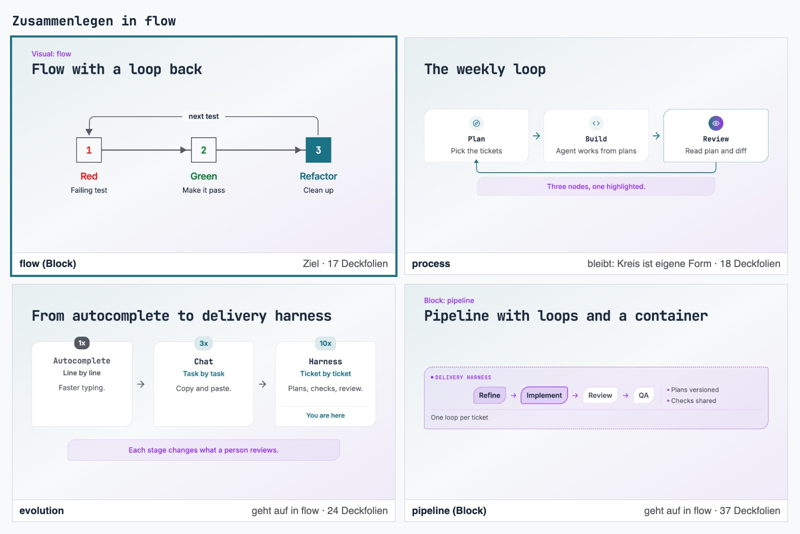

| Eintrag       | Deckfolien | Wertung | Was anders ist                                                       |
| ------------- | ---------: | ------: | -------------------------------------------------------------------- |
| `flow` (Ziel) |         17 |         | Schritte mit Pfeil, Icon, Farbton, Hervorhebung, optional Rückpfeil  |
| `evolution`   |         24 |         | Stufen mit Multiplikator und Badge, Stufen gedimmt oder betont       |
| `pipeline`    |         37 |         | Stufen mit Status und Logos, Schleifen, Rahmen mit Logos und Notizen |
| `process`     |         18 |    7,75 | bleibt: Kreis aus N Knoten, die Form zeigt die Schleife              |

`flow` ist die neueste und schlichteste Form. `evolution` braucht dort ein Badge je Schritt,
`pipeline` den Rahmen um die Stufen. `process` liegt im Panel oben und zeigt eine eigene Form,
deshalb bleibt es. `lanes` (parallel) und `layers` (Stapel) zeigen andere Beziehungen und bleiben.
Zeile `merge-flow`.

### 4. Deck-Übersicht: drei Formen, Ziel `phased-pills`

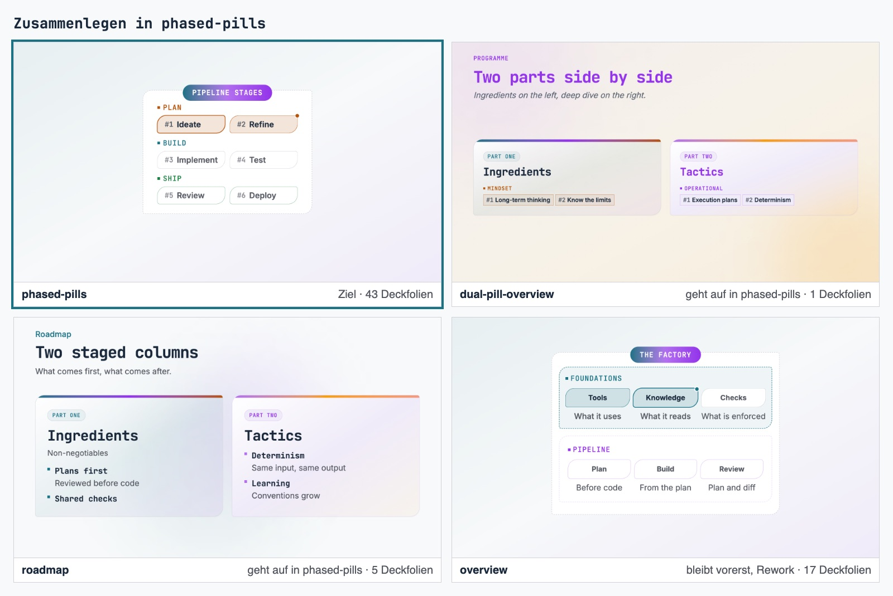

| Eintrag               | Deckfolien | Wertung | Was anders ist                                                   |
| --------------------- | ---------: | ------: | ---------------------------------------------------------------- |
| `phased-pills` (Ziel) |         43 |    5,58 | Phasen mit nummerierten Pillen und Status                        |
| `dual-pill-overview`  |          1 |    4,92 | zwei `phased-pills`-Spalten mit Akzent Zutaten oder Deep Dive    |
| `roadmap`             |          5 |    6,50 | zwei Spalten mit Punkten und Beschreibung, Punktfarbe je Eintrag |
| `overview`            |         17 |    6,17 | bleibt vorerst: Doppelspur der Factory-Talks, wird überarbeitet  |

Alle vier liegen unter 6,6. Das Ziel bekommt eine optionale zweite Spalte. Die Akzentfarbe der
Spalten entscheidet dd- (Deep-Dive-Look), deshalb wartet diese Gruppe auf dd-. Zeile
`merge-phased-pills`.

### 5. Zahlen: zwei Formen, Ziel `numbers`

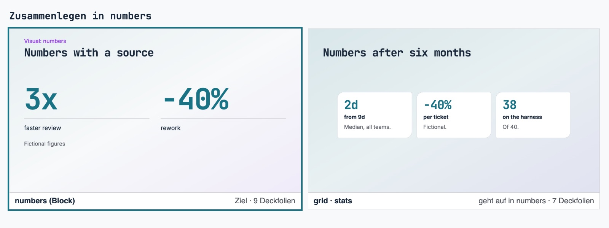

`numbers` (9 Folien) setzt Wert, Bezeichnung und Quelle. `grid` `stats` (7) setzt dieselben Werte in
Karten mit Icon und Beschreibung. Die Quelle, die `numbers` mitbringt, fehlt `grid` `stats`. Zeile
`merge-numbers`.

### 6. Textfolie: zwei Formen, Ziel `content`

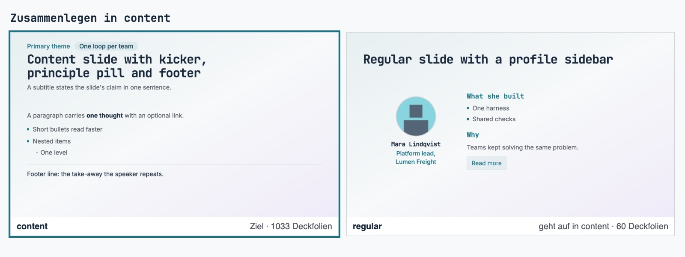

`regular` (60 Folien, 54 davon in talks) setzt Abschnitte mit Titel, Liste, Text, Link und Icon,
optional eine Profil-Seitenleiste. `content` (1.033) setzt dasselbe aus Blöcken. Die Seitenleiste
wird eine Option von `content`. Größte Umstellung in Phase 4. Zeile `merge-content`.

### 7. Einzelaussage: zwei Formen, Ziel `statement`

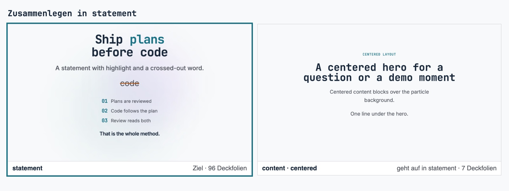

`content` `centered` (7 Folien) zentriert beliebige Blöcke als Hero. Vier der sieben tragen einen
verlinkten QR-Code (`linked-image`), je eine `positions`, `terminal` und Text mit Hinweis. `statement` (96, Wertung 5,75)
setzt eine Aussage mit Hervorhebung, Streichung, Punkten und Zitat. `statement` braucht ohnehin
Arbeit: Die Reviewer rügten das Leuchten hinter dem Inhalt und das durchgestrichene Wort, das mit der
Überschrift konkurriert. Für die QR-Folien bekommt `statement` ein verlinktes Bild, die
`positions`-Folie geht mit Gruppe 2, die `terminal`-Folie bleibt `content` ohne Zentrierung.
Zeile `merge-statement`.

## Lücken: was fehlt

Nach Kommunikationsaufgabe, mit der Quelle, warum ein Deck sie braucht (Quellen im Abschnitt
"Recherche"), und der Zahl der Folien, die sie heute von Hand bauen.

| Aufgabe               | Neuer Eintrag                                              | Warum, Quelle                                                                       | Folien heute                                     |
| --------------------- | ---------------------------------------------------------- | ----------------------------------------------------------------------------------- | ------------------------------------------------ |
| Interaktion und Übung | Übung: Aufgabe, Zeitbox, Schritte, Ergebnis, optional Code | Bowmans Concrete Practice und Conclusion (8)                                        | 56, aus Absatz, Liste, Code                      |
| Orientieren           | `agenda` als Zeitplan                                      | Bookends und Context Keeper (7), Agenda-Folie (2)                                   | 19, als Tabelle oder Zeitleiste                  |
| Code und Demo         | Demo: was gezeigt wird, worauf achten, Rückfall            | Live Demo gegen Dead Demo (7)                                                       | mindestens 10, als Trenner oder zentrierte Folie |
| Schließen             | Nächste Schritte: Entscheidung, Schritte, wer, bis wann    | "States the decision needed and the specific next steps, owners, and deadlines" (2) | 4 mit dem Titel, als `regular` oder Trenner      |
| Bild                  | Vollbild mit Text darauf                                   | Reynolds, Vollbild mit Text in freier Fläche (9)                                    | 0, die Engine kann es nicht                      |
| Daten                 | Anteil am Ganzen, Abweichung vom Ziel                      | Part-to-whole und Deviation (3), Component (4)                                      | 0                                                |

Die letzten beiden nur, wenn ein Deck sie braucht: Heute braucht sie keins, ohne Bedarf wären sie
Vorrat.

**Gemaltes Bild:** kein neuer Typ. Die Variante `image-and-grid` `sketch` kommt ins Specimen-Deck
und auf die Seite. Die Regel im README bleibt: Sketch nur auf der Konzeptfolie mit bis zu vier
Karten. Auf Titel, Trenner, Vergleich, Statement und Abschluss verlor er in den Panels vom 31.10.
(os `docs/tracking/2026-10-31-slide-visuals.md`).

**Team Topology:** Phase 2 baut sie in der Formensprache der Team Shape Templates (10): Stream-Team
waagerecht, Enabling senkrecht, Subsystem als Achteck, Plattform mit gepunktetem Rand, in
Markenfarben ohne Rot, und mit Abstand zum Fußband. `decision` (Benedikt: "stark") bleibt im Bild,
verliert aber die feste Bindung an die drei Teamarten (`team`), damit es jede Ja-Nein-Verzweigung
trägt.

## Bestand

Gezählt am 2026-11-01 durch Import jedes Decks und Lesen von `slides` je Folie. Engine `2608eb8`
(v0.10.1). talks von `origin/main` `d2bd285`, trainer-hub `17403311` (Decks gleich wie
`origin/main` `cc468633`), hycle-private `d15a81a` (pinnt noch v0.8.0, talks und trainer-hub
v0.10.0). "Roh" zählt jede Folie, "einmalig" zählt Folien mit gleichem Inhalt einmal, denn
Trainings-Lieferungen sind Kopien des Standards. Notizen zählen dabei nicht mit.

| Repo        | Decks | Folien roh |
| ----------- | ----: | ---------: |
| talks       |    12 |        442 |
| trainer-hub |    39 |      1.674 |
| hycle       |     1 |         41 |
| zusammen    |    52 |      2.157 |

Einmalig sind es 1.687 Folien. Das Specimen-Deck `slide-catalogue` hat 89 Folien, dazu dieselben
89 im Theme brand-dark.

### Folientypen

Aufgabe: die Kommunikationsaufgabe aus dem Abschnitt "Abdeckung". Specimen: Folien im
Specimen-Deck, die Seite zeigt davon immer nur die erste.

| Typ                  |   roh | einmalig | Varianten in Decks (einmalig)            | Specimen | Aufgabe                |
| -------------------- | ----: | -------: | ---------------------------------------- | -------: | ---------------------- |
| `content`            | 1.343 |    1.033 | `centered` 7                             |       32 | Erklären, alle Blöcke  |
| `transition`         |   243 |      155 |                                          |        2 | Orientieren            |
| `statement`          |   129 |       96 | `quote` 1                                |        2 | Eine Aussage           |
| `regular`            |    60 |       60 | `cards` 1, 54 der 60 in talks            |        3 | Erklären, Menschen     |
| `grid`               |    56 |       54 | `pillars` 45, `stats` 7, `quotes` 2      |        5 | Erklären, Eine Aussage |
| `title`              |    50 |       44 |                                          |        2 | Eröffnen               |
| `phased-pills`       |    43 |       43 |                                          |        1 | Orientieren            |
| `closing`            |    39 |       31 | `contact` 13, `discussion` 12            |        3 | Schließen              |
| `media`              |    38 |       35 | `grid` 15, `row` 2, einzeln 18           |        5 | Bild                   |
| `overview`           |    30 |       17 |                                          |        2 | Orientieren            |
| `process`            |    24 |       18 |                                          |        2 | Ablauf                 |
| `evolution`          |    24 |       24 |                                          |        2 | Ablauf                 |
| `comparison`         |    21 |       21 | `vs` 12, `split` 7, `before-after` 2     |        3 | Vergleichen            |
| `profiles`           |    10 |       10 |                                          |        2 | Menschen               |
| `chart`              |    10 |        9 | `trend` 5, `bar` 4, `cycle` 0, `graph` 0 |        4 | Daten                  |
| `gantt`              |     7 |        7 |                                          |        2 | Zeitplan               |
| `roadmap`            |     5 |        5 |                                          |        1 | Orientieren            |
| `agenda`             |     5 |        5 |                                          |        2 | Orientieren            |
| `wheel`              |     4 |        4 |                                          |        2 | Struktur               |
| `team-topology`      |     3 |        3 |                                          |        2 | Struktur               |
| `lanes`              |     3 |        3 |                                          |        3 | Ablauf                 |
| `decision`           |     3 |        3 |                                          |        2 | Struktur               |
| `question`           |     2 |        2 |                                          |        1 | Interaktion            |
| `guidance`           |     2 |        2 |                                          |        2 | Vergleichen            |
| `deep-dive-divider`  |     2 |        2 |                                          |        1 | Orientieren            |
| `dual-pill-overview` |     1 |        1 |                                          |        1 | Orientieren            |

### Inhaltsblöcke

Einmalige Folien, die den Block tragen. Von 1.033 einmaligen Inhaltsfolien sind 386 (37 %) reiner
Text aus Absatz, Liste und Hinweis, 255 tragen ein Diagramm, Karten oder ein Bild, 227 eine
Tabelle, 96 Code.

| Block            | Folien | Varianten                                                                                                |
| ---------------- | -----: | -------------------------------------------------------------------------------------------------------- |
| `paragraph`      |    549 |                                                                                                          |
| `bullets`        |    396 | `ordered` 13                                                                                             |
| `table`          |    227 | `compact` 74                                                                                             |
| `callout`        |    199 | `info` 146, `warning` 32, `success` 14                                                                   |
| `two-column`     |    105 | `neutral` 50, ohne 26, `error-success` 10, `success-error` 10, `error` 4, `error-neutral` 3, `success` 2 |
| `cards`          |    100 | `numbered` 9                                                                                             |
| `code`           |     79 |                                                                                                          |
| `pipeline`       |     37 |                                                                                                          |
| `image-and-grid` |     19 | gerahmt 15 (davon 6 Sketches ohne Flag), `sketch` 4                                                      |
| `image`          |     18 |                                                                                                          |
| `flow`           |     17 |                                                                                                          |
| `timeline`       |     17 |                                                                                                          |
| `labeled-grid`   |     16 |                                                                                                          |
| `four-column`    |     11 |                                                                                                          |
| `code-and-text`  |      9 |                                                                                                          |
| `numbers`        |      9 |                                                                                                          |
| `annotated-code` |      7 |                                                                                                          |
| `transform`      |      6 |                                                                                                          |
| `hooks`          |      5 |                                                                                                          |
| `linked-image`   |      4 |                                                                                                          |
| `bars`           |      2 |                                                                                                          |
| `layers`         |      1 |                                                                                                          |
| `positions`      |      1 |                                                                                                          |
| `terminal`       |      1 |                                                                                                          |
| `video`          |      0 |                                                                                                          |
| `annotated`      |      0 |                                                                                                          |

### Was am Katalog vorbeigeht

Keine eigene Komponente, kein HTML im Folientext (die Treffer stehen in Notizen und Code). Die
Abweichungen sind Stellschrauben und Behelfe:

- **`background` überschrieben** auf 8 Folien in 4 Decks: `bg-section-accent` 5,
  `bg-section-growth` 2, `bg-section-secondary` 1. `bg-section-growth` definiert `slides.css` nicht,
  die zwei Trennerfolien stehen ohne Abschnittsfläche.
- **`accentColor`** auf Karten von 21 `grid`-Folien, **`dotColor`** auf einer `roadmap`-Folie: Farbe
  je Karte statt aus der Abschnittsrolle.
- **Sketch ohne Flag:** Bei 6 Sketches im trainer-hub (`sketch-*.png` in `image-and-grid`) fehlt
  `sketch: true`. Seit v0.10.0 stehen sie deshalb in einer Karte.
- **Agenda als Tabelle:** 13 Folien mit "Agenda", "Zeitplan" oder "Ablauf" im Titel sind
  `content` mit einer Tabelle, 6 weitere eine Zeitleiste. Der Typ `agenda` kann nur eine
  nummerierte Liste.
- **Übung von Hand:** 56 einmalige Folien mit "Übung", "Exercise", "Hands-on", "Challenge" oder
  "Aufgabe" im Titel, gebaut aus Absatz, Liste, Code und Hinweis, jede anders.
- **Demo von Hand:** Demo-Momente sind `content` `centered` oder ein Trenner mit "Demo" im Titel.
- **hycle** pinnt v0.8.0 und hat damit weder rahmenlose Sketches noch die neue Abschnittsfläche.

### Was die Specimen-Seite heute zeigt

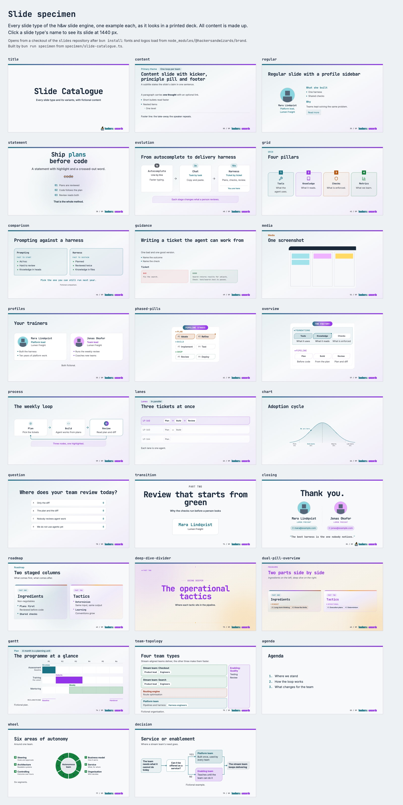

`scripts/specimen.ts` rendert je registriertem Typ die erste Folie des Specimen-Decks: 26 Kacheln,
alphabetisch nach Registrierung, ohne Beschreibung. Daraus folgt:

- Von 26 Inhaltsblöcken zeigt die Seite zwei (Absatz und Liste auf der ersten `content`-Folie).
  Diagramme (`flow`, `timeline`, `bars`, `cards` und die übrigen), Code, Tabellen und
  `image-and-grid` sind nicht zu sehen.
- Keine Variante ist zu sehen: `grid` zeigt nur `pillars`, `chart` nur `cycle`, der in keinem Deck
  vorkommt, `closing` nur `contact`.
- Das gemalte Bild fehlt doppelt. Die Seite zeigt den Block nicht, und das Specimen-Deck füllt ihn
  mit einem gezeichneten Screenshot ohne `sketch: true`:

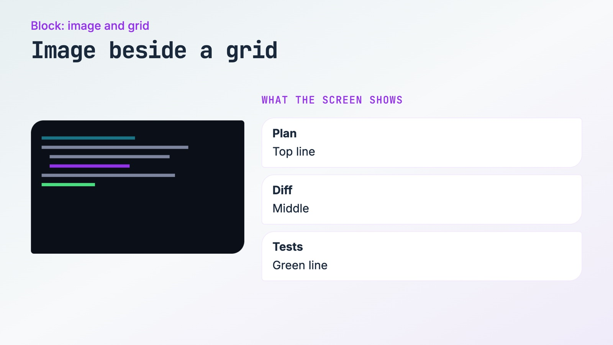

- `team-topology` heute: vier gleiche Kästen, das Subsystem-Team in Rot.

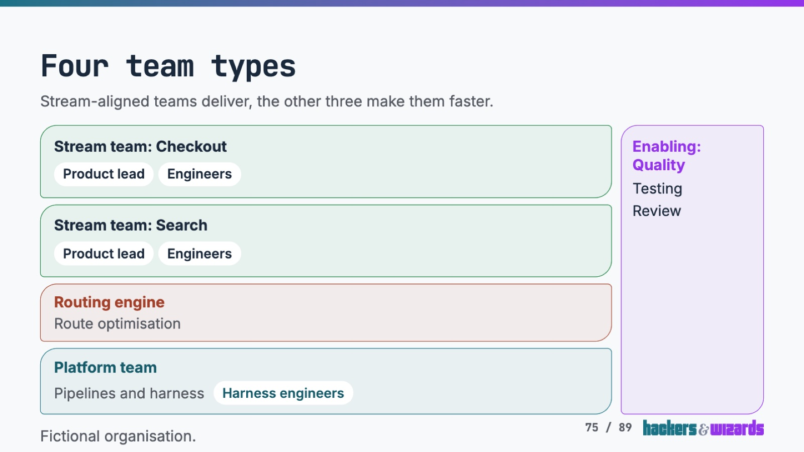

## Recherche

Alle Quellen am 2026-11-01 abgerufen.

1. Google Slides, vordefinierte Layouts: Title, Section header, Section title and description,
   Title and body, Title and two columns, Title only, One column text, Main point, Big number,
   Caption, Blank.
   https://developers.google.com/apps-script/reference/slides/predefined-layout
2. Deckary, "Presentation Design: The Complete Guide to Professional Slide Types": 15 Typen, darunter
   Section Divider, Two- und Three-Column, Chart, Comparison Table, Timeline (Roadmap, Gantt),
   Framework (Process Diagram), Case Study, Testimonial, Appendix und Closing mit "next steps".
   Ein Anbieterblog, also eine Rekonstruktion, keine veröffentlichte Beraterquelle.
   https://deckary.com/blog/pillar-slide-types-guide
3. Financial Times, Visual Vocabulary: Deviation, Correlation, Ranking, Distribution, Change over
   Time, Part-to-whole, Magnitude, Spatial, Flow.
   https://github.com/Financial-Times/chart-doctor/tree/main/visual-vocabulary
4. Gene Zelazny, "Say It With Charts", fünf Vergleiche: Component, Item, Time series, Frequency
   distribution, Correlation (nach Bissantz).
   https://www.bissantz.de/bissantz-ponders/comparisons-1/?lang=en
5. Duarte, Glance Test: Versteht das Publikum den Kernpunkt "in 3 seconds or less"? "Sharpen your
   focus to a single, precise point on each slide."
   https://www.duarte.com/resources/guides-tools/the-glance-test/
6. Mayer, Prinzipien multimedialen Lernens, darunter Coherence ("exclude extraneous, potentially
   distracting, material"), Signaling ("highlight the key content and its organization"), Spatial
   Contiguity, Segmenting.
   https://teaching.pitt.edu/wp-content/uploads/2023/03/multimedia-principles-checklist.pdf
7. Ford, McCullough, Schutta, "Presentation Patterns" (2012), Inhaltsverzeichnis: Takahashi, Cave
   Painting, Context Keeper, Breadcrumbs, Bookends, Charred Trail, Live Demo gegen Dead Demo,
   Traveling Highlights, Antipattern Bullet-Riddled Corpse.
   https://ptgmedia.pearsoncmg.com/images/9780321820808/samplepages/0321820800.pdf
8. Sharon Bowman, Training from the BACK of the Room, 4Cs: Connection, Concept, Concrete Practice
   (etwa ein Teach Back zu zweit), Conclusion (eine konkrete Handlung, auf die man sich festlegt).
   https://www.infoq.com/news/2018/07/brain-based-learning
9. Garr Reynolds: "try designing your slide so that it features an image fullscreen (or full
   bleed)" und den Text "on top in an area with good empty space".
   https://garrreynolds.com/design-tips
10. Team Topologies, Team Shape Templates: Stream-aligned "horizontally aligned with rounded
    corners", Enabling "vertically aligned with rounded corners", Complicated subsystem "an
    octagon", Platform "square corners with a dotted border".
    https://github.com/TeamTopologies/Team-Shape-Templates

Aus 1, 2 und 7 folgt das Gerüst eines Decks (Öffnen, Orientieren, Aussage, Schließen), aus 3 und 4
die Datenaufgaben, aus 8 die Werkstattaufgaben, die Talk-Taxonomien nicht kennen: Anknüpfen, üben,
festlegen. 5 und 6 sind Prüfkriterien für jede Runde in Phase 2, keine Typen.

### Abdeckung je Kommunikationsaufgabe

Ein Eintrag ist ein Typ, ein Block oder eine Variante. Ein Eintrag kann in zwei Aufgaben stehen.

| Aufgabe                   | Quelle  | Einträge heute                                                                                            | Urteil                                                                                 |
| ------------------------- | ------- | --------------------------------------------------------------------------------------------------------- | -------------------------------------------------------------------------------------- |
| Eröffnen und schließen    | 1, 2    | `title`, `closing`                                                                                        | gedeckt; Schließen ohne "Nächste Schritte"                                             |
| Orientieren               | 1, 2, 7 | `agenda`, `transition`, `deep-dive-divider`, `overview`, `phased-pills`, `dual-pill-overview`, `roadmap`  | doppelt: drei Übersichten (Gruppe 4); Agenda als Zeitplan fehlt                        |
| Eine Aussage              | 1, 5, 7 | `statement`, `numbers`, `grid` `stats`, `content` `centered`                                              | gedeckt; doppelt (Gruppen 5 und 7)                                                     |
| Erklären                  | 1, 2    | `content` mit Text, `regular`, `cards`, `grid` `pillars`, `labeled-grid`, `four-column`, `hooks`, `table` | doppelt: fünf Kartenformen, `regular` neben `content` (Gruppen 1 und 6)                |
| Vergleichen               | 2, 4    | `comparison`, `two-column`, `transform`, `guidance`, `positions`                                          | doppelt: vier ganzseitige Formen (Gruppe 2), `two-column` bleibt Block                 |
| Ablauf und Prozess        | 2       | `flow`, `process`, `evolution`, `pipeline`, `lanes`, `layers`                                             | doppelt: drei lineare Formen (Gruppe 3)                                                |
| Zeitplan und Plan         | 2       | `timeline`, `gantt`                                                                                       | gedeckt, `gantt` stark (Benedikt)                                                      |
| Daten                     | 3, 4    | `chart`, `bars`, `numbers`                                                                                | schwach: kein Anteil am Ganzen, keine Abweichung vom Ziel; in Decks selten (20 Folien) |
| Struktur und Organisation | 10      | `team-topology`, `wheel`, `decision`                                                                      | `team-topology` schwach; `decision` stark (Benedikt), aber fest an Teamarten gebunden  |
| Bild und Skizze           | 7, 9    | `media`, `image`, `image-and-grid`, `annotated`, `linked-image`, `video`                                  | schwach: kein Vollbild mit Text darauf; gemaltes Bild nicht im Specimen                |
| Code und Demo             | 7       | `code`, `code-and-text`, `terminal`, `annotated-code`                                                     | Code gedeckt; Demo fehlt                                                               |
| Menschen                  | 2       | `profiles`, `regular` mit Profil                                                                          | gedeckt                                                                                |
| Interaktion und Übung     | 8       | `question`                                                                                                | Übung fehlt (56 Folien von Hand)                                                       |

## Katalogseite: Vorschlag

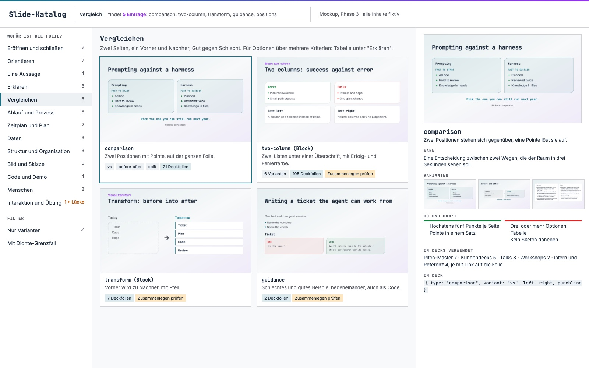

Die Seite bleibt `specimen/index.html`, aus dem Specimen-Deck generiert und vom Gate auf Frische
geprüft. Neu:

- **Navigation nach Aufgabe.** Links die 13 Aufgaben aus der Tabelle oben, mit Zahl der Einträge
  und einer markierten Lücke. Ein Eintrag darf in zwei Aufgaben stehen.
- **Suche.** Ein Feld filtert über Name, Aufgabe, Synonyme und "Wann". "vergleich" findet
  `comparison`, `two-column`, `transform`, `guidance` und `positions`. Statisch, ohne Server: ein
  paar Zeilen JavaScript über ein eingebettetes JSON.
- **Jeder Eintrag sichtbar.** Typen, Blöcke und Varianten bekommen je eine Kachel, heute wären das
  52 Einträge plus Varianten statt 26 Kacheln. Das Mockup zeigt den Stand vor dem Zusammenlegen.
- **Je Eintrag eine Detailansicht:** große Folie, ein Satz "Wann", Varianten als kleine Folien,
  Do und Don't in je zwei Zeilen, Zahl der Deckfolien je Deckfamilie und der Typname, wie er im
  Deck steht.
- **Woher die Texte kommen:** "Wann" und Do und Don't stehen als Metadaten neben der Folie im
  Specimen-Deck. Der Test, der heute jeden Typ im Specimen verlangt, verlangt dann auch diese
  Felder.
- **Deckfolien je Typ.** Die Engine ist öffentlich und darf keine Kundendecks lesen (CLAUDE.md,
  `coupling.md`). Die Zählung je Deckfamilie liefert jeder Verbraucher selbst, als Befehl im
  eigenen Gate. Auf der öffentlichen Seite stehen nur Zahlen ohne Decknamen, oder gar nichts
  davon. Das entscheidet Phase 3, die Zahlen im Mockup kommen aus dieser Zählung.

## Plan

### Phase 2: Typen optimieren und ergänzen

1. **Basis-Runde.** Jeder Eintrag einmal im Blind-Panel, mit einer Folie aus dem Specimen und bis
   zu drei echten Deckfolien je Eintrag (die längste, die dichteste, eine typische), damit
   Grenzfälle zählen. Personas wie am 31.10.: Engineering-Leitung im Raum, Vorstand, Teilnehmer
   in der letzten Reihe, Meet-Teilnehmer bei 960 x 540, dazu ein Brand-Designer. Claude und Codex,
   zwei Läufe, Rauschen gemessen. Kriterien vorher fest: Glance-Test (5), Klarheit, Lesbarkeit,
   Ruhe und Platz, Markentreue nach Design Guide, AI-Anmutung. Der Prompt nennt alle
   Markenfarben samt Rollen, nicht nur Teal und Purple (tm- nennt das als Grenze seines Panels).
   Vor jeder Runde der
   Markencheck je Kandidat: Farbrollen, Deckkraftleiter, kleine Ecken quadratisch, Verlauf als
   begrenztes Feld.
2. **Reihenfolge** = niedrige Wertung mal Nutzung. Für die 26 Typen liegt die Wertung schon vor
   (tm-, siehe unten), die Basis-Runde bewertet nur noch die 26 Blöcke und echte Deckfolien. Die
   Reihenfolge nach heutigem Stand: `statement` (5,75, 96 Folien), `team-topology` (5,83),
   `phased-pills` mit Gruppe 4 (5,58, 43 Folien, nach dd-), `chart` (6,33), `wheel` (6,42), dann
   die Zusammenlegungen nach Folienzahl (Gruppen 1, 3, 6, 2, 5, 7) und `content` mit Text (386
   reine Textfolien). `dual-pill-overview` (4,92) und `deep-dive-divider` (5,08) liegen ganz unten,
   gehören aber zu dd-.
3. **Optimieren bis zum Plateau,** je Eintrag zwei bis drei Runden, nach der Stoppregel aus
   `blind-review`.
4. **Neue Einträge:** Übung, Agenda als Zeitplan, Demo, Nächste Schritte, Sketch-Variante im
   Specimen. Jeder landet zuerst im Specimen-Deck.
5. **Zusammenlegen,** je Gruppe nach Benedikts Antwort auf ihre `merge-*`-Zeile: die Zielform
   gegen die Originale auf echten Deckfolien. Gleichauf im Rauschen reicht, der Gleichstand geht an die
   Form mit weniger Ausnahmen.
6. **Release** je Batch: Version, Tag, Verbraucher heben den Pin in Phase 4.

### Phase 3: Katalogseite

Der Vorschlag oben, gebaut in `scripts/specimen.ts`. Prüfung: kleines Panel aus Trainerin, die
eine Folie sucht, und Designer, mit Suchaufgaben ("eine Folie für einen Zeitplan") und gemessener
Zeit bis zum Treffer, alte Seite gegen neue.

### Phase 4: Decks umstellen

Je zusammengelegtem oder neuem Typ ein Codemod über alle Decks in talks, trainer-hub und hycle,
jeweils in deren Repo. Dazu: die 56 Übungsfolien, 13 Agenda-Tabellen und 6 Agenda-Zeitleisten auf die neuen Typen, die
6 Sketch-Flags, die 8 `background`-Overrides, `accentColor` und `dotColor` auf Abschnittsrollen,
hycle auf den aktuellen Pin. Fertig, wenn jede Folie einen Katalogeintrag nutzt, keine
Stellschraube außerhalb des Katalogs mehr steht und `slides-density` in allen drei Gates grün ist.
Ein Typ, der aus der Union fällt, bricht den Typecheck jedes Decks, das ihn nutzt. Deshalb zieht
Phase 4 alle Decks um, ausgelieferte eingeschlossen (`catalogue-migration-scope`). Verschickte PDFs
bleiben, wie sie sind.

### Aufwand

Methode 1, Einheiten: 26 Blöcke und Deckfolien in der Basis-Runde (eine Session, etwa 3 h), dann etwa 20
Einträge mit Arbeit (die Schwächsten, die Neuen, die Zusammenlegungen) zu je etwa 2 h für Bau und
zwei Panelrunden. Das sind rund 40 h Agentenzeit, mit drei parallelen Sessions in eigenen Worktrees
etwa 14 h Wanduhr. Phase 3 eine Session von 4 bis 6 h. Phase 4 rund ein Tag, weil die Gates der
Verbraucher mit Build und Dichte-Guard lange laufen.

Methode 2, gemessene Geschwindigkeit: slides hat vom 30.10. 21:37 bis 01.11. 05:59 rund 20
Releases veröffentlicht. Titel- und Schlussfolie samt Panels liefen von v0.4.2 (08:12) bis v0.5.1
(13:31), gut 5 h für ein Typenpaar. Bei 2,5 bis 5 h je Eintrag und 20 Einträgen sind das 50 bis
100 h, mit drei Sessions 17 bis 33 h Wanduhr.

Beide Methoden zusammen: Phase 2 dauert 2 bis 4 Tage Wanduhr, das Programm 4 bis 6 Tage. Alle Zahlen
sind meine Schätzung, gemessen sind nur die Release-Zeiten und die Folienzahlen.

### Wie die anderen Läufe einfließen

- **gd-** (Richtung der Abschnittsfläche) ist mit v0.10.1 ausgeliefert. Die Basis-Runde rendert
  auf diesem Stand, die Richtung wird nicht neu verhandelt.
- **dd-** (Deep-Dive-Look) hat die drei schwächsten Typen im Auftrag: `dual-pill-overview` 4,92,
  `deep-dive-divider` 5,08, `phased-pills` 5,58. Gruppe 4 wartet auf sein Ergebnis und baut auf
  ihm auf.
- **tm-** (os `docs/tracking/2026-11-01-title-closing-max.md`): Wertung je Typ für alle 26 Typen,
  eine Runde, zwei Läufe, Rauschen 0,33. Schwächste: die drei von dd-, dann `statement` 5,75,
  `team-topology` 5,83, `overview` 6,17, `chart` 6,33, `wheel` 6,42, `gantt`, `guidance` und
  `roadmap` je 6,50. Oben: `title` 8,42, `agenda` 8,00. Diese Wertungen ersetzen die Basis-Runde
  für die Typen. Sein Brand-Absatz nannte nur Teal und Purple als Akzente, die Kritik "Grün außerhalb
  der Palette" an `wheel` und `phased-pills` ist deshalb teils ein Artefakt des Prompts. Titel und
  Abschluss optimiert Phase 2 nicht: tm- empfiehlt beide auf Night, das wartet auf Benedikt
  (os-Zeile `title-closing-dark`).
- **pc-** (v0.10.0: Personenfarben, Tabellen, rahmenlose Sketches) ist der Ausgangsstand.

## Annahmen

- Folien mit gleichem Inhalt in mehreren Decks zählen für die Rangfolge einmal, Notizen außen vor.
- Die Aufgaben-Taxonomie ist meine Synthese aus den Quellen 1 bis 10, kein übernommenes Schema.
- "Übung" und "Agenda als Zeitplan" sind nach Titelstichworten gezählt. Eine Folie ohne Stichwort
  im Titel fehlt in der Zählung.
- Die Katalogseite bleibt im öffentlichen slides-Repo und zeigt nur fiktive Inhalte.
- Der Block `two-column` (105 Folien) bleibt neben `comparison`: Er teilt sich die Folie mit
  anderen Blöcken.
- `process`, `lanes` und `layers` bleiben: Kreis, parallele Bahnen und Stapel sind eigene Formen.
- `overview` bleibt vorerst und wird in Gruppe 4 überarbeitet, nicht aufgelöst.
- `video`, `annotated`, `chart` `cycle` und `chart` `graph` nutzt kein Deck. Sie bleiben, solange
  das Specimen-Deck sie zeigt. Was nach Phase 4 ungenutzt ist, kommt als Liste zu Benedikt.
- Die Specimen-Folien in den Gruppenbildern sind fiktiv. Die Panels in Phase 2 nehmen zusätzlich
  echte Deckfolien, die nicht in dieses öffentliche Repo gehören.

## Ausgelassen

- Keine eigene Wertung in Phase 1: tm- hat die 26 Typen bewertet, die Blöcke bewertet Schritt 1
  von Phase 2.
- Keine Dichtemessung neu: Stand ist os `docs/tracking/2026-10-31-deck-density.md` (31.10.,
  v0.4.7), seither läuft der Guard mit Schwelle 0,8 in jedem Gate.
- Kein Anteil-am-Ganzen- oder Abweichungsdiagramm: kein Deck braucht es heute. Aufnehmen, sobald
  ein Readout es braucht.
